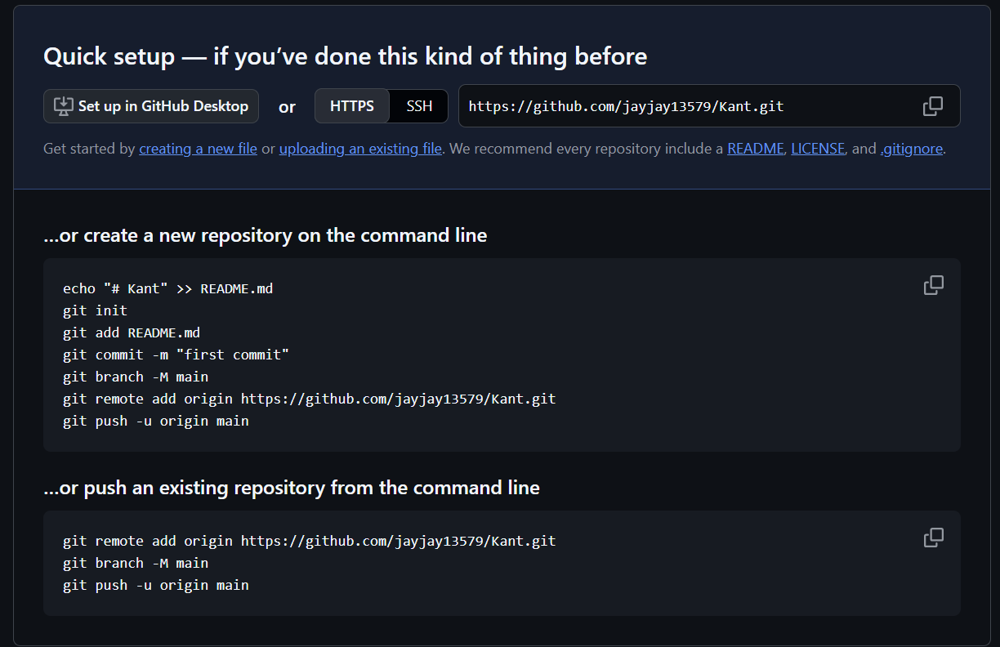

## 소제목

### 작은 제목

> 인용문

**굵은글씨**

- 체크박스

|항목|설명|
|---|---|
|ㅇ|ㅇ|

```python
print("hello world")
```

<details> 
d
d
d
</details>

d

✨


- [x] 체크


| 항목 | 설명 |
|---|---|
|A|B|

앞으로 터미널에서 프로그램 설치. 터미널?? / 맥은 홈브루 / 윈도우는 윙겟(?)

첫 수업 : 깃 Git / 깃 배쉬 쉘 명령어 사용.

왜 파워 셀을 쓰지x? 서버단에서 리눅스 쉘 사용

[터미널에서 git프로그램 설치하기]
터미널 > powershell 상태 > winget 작성 후 실행 > 마지막 행 winget search git 작성 후 실행, Y로 확인 (git이 들어간 프로그램 목록 조회) > Git에 해당하는 id (Git.Git) 으로 설치해야함 > winget install -i Git.Git *-i는 인터랙션 옵션 방식으로 설치한다는 것. id는 대소문자 정확히 구분 필요. => 웹사이트에 들어가서 설치파일 다운받고 인스톨하는 과정을 명령어 한줄로 정리 가능


winget은 맥의 homebrew를 윈도우에서 그대로 구현한 것. winget으로 설치하면 윈도우와 달리 프로그램 레지스트리까지 찌꺼기 남기지 않고 완전히 지울 수 있음

화살표 업 다운 키로 이전 명령어 왔다갔다 가능

안되면 git-scm.com에 가서 직접 다운>

option에서 check daily`~/add agit bash ~ 설정 체크해야 함

override the default 옵션 체크

vscode도 winget으로 설치(-i 옵션 없이)

CLI, 리눅스 셀 명령어 , 터미널 활용할 수 있어야 함

[깃, 깃허브- 커밋 하나에서 팀 협업 깃 플로우까지]

깃 : 버전 관리 시스템, 형상 관리 도구  / 파일의 변경 이력을 기록, 원하는 시점으로 되돌릴 수 있음 / 분산형 시스템. 기존 중앙 집중형 버전 관리 시스템과 달리 모든 개발자가 전체 이력을 가진 로컬 저장소를 가짐. 중앙 서버에 문제가 있어도 소스코드 유실이 없고, 작업을 계속 이어나갈 수 있음.
 ㄴ능숙하게 다룰 수 있어야 함. 개발자의 기본 소양임!!
ㅁ명령어가 140개 정도 되지만 옵션에 따라 다양한 조합이 가능해짐 
-> ㅂ배우기 어렵

깃허브 : 깃 원격 저장소를 호스팅하는 웹 서비스
세계 최대의 오픈소스 저장소
= 유사 서비스 : 깃 랩, 빗버킷
지금은 마이크로소프트꺼

깃허브를 포트폴리오로 활용

풀 리퀘스트(PR), 이슈스(발생 이슈 트랙킹), 액션스 등 협업기능 제공

깃은 내 컴퓨터에서 동작하는 도구, 깃 허브는 깃 저장소? 소스코드를 올려두고 함께 쓰는 서비스, 깃 허브 없이도 깃은 쓸 수 있다.

[필수개념]

처음부터 GUI툴을 이용해 깃을 사용하면 나중에 협업시 문제 해결어려울 수 있음
CLI?CLR? 언어를 사용하는 연습해야함 ㄱ
그래야 꼬인 프로젝트 해결 가능

1) 리포지토리(줄여서 리포) : 프로젝트의 변경 이력(커밋) 저장 / 
로컬 리포() OR 원격 리포()

2) 깃의 3가지 영역 : 워킹 디렉토리(작업 폴더. 실제로 파일을 편집하는 곳), 스테이징 에리어(인덱스. 다음 커밋(저장 단위)에 담을 변경을 골라 두는 영역, 논리적 영역. 깃이 자동으로 관리해줌. 눈에 안띔. 작업중인 5개 파일 중 작업 완료된 3개만 레퍼지토리에 올릴 수 있게 해줌?), 레퍼지토리(커밋, 스냅숏(커밋의 이력 단위) 이력이 저장되는 영역) 
깃

스냅샷 : 1기가 ㅍ파일 중 수정된 일부 용량만 저장할 수 있게 도와줌.을 쓰는 이유? 백업하려고

[핵심 명령어]
워킹 디렉토리 -애드-> 스테이징 에리어 -커밋-> 로컬 리포 <---푸쉬/풀(자동 알람)---> 원격 리포


원격저장소가 필요한 이유? 1.협업. 서로 다른 곳에 있는 개발자가 하나의 원격 저장소를 통해 작업을 주고 받음 
/ 2.ㅈ작업장소 변경

git add 파일(변경사항) 중 이력에 남길 것만 골라 staging area에 올림
커밋 메시지를 보고 원하는 시점을 찾아 되돌릴 수 있도록 의미있게 써야함

컨벤션 규칙 반드시 지켜야 함

깃 리버트 : 협업시, A라는 팀원이 잘못된 코드를 푸쉬. ㄱ그런데 ㄷ다른 팀원이 모르고 받아갔을 때, 리버트 써야 함

깃 리셋 : 현재 브랜치를 지정한 커밋으로 이동시킨다.  
커밋만 날리는 것이 SOFT, MIXED 옵션 스테이징에 올라가지 않은 상태, 하드 옵션 작업까지도 버림

깃 리버트 : 지정한 커밋의 변경을 반대로 적용하 ㄴ새 커밋을 만듦. 이력은 그대로 남음. / 리셋은 이력을 되감고(내 로컬 정리용), 리버트는 이력에 되돌림을 추가(공유된 브랜치에 안전)


브랜치 
: 특정 커밋을 각리키는 움직이는 포인터. 본 작업과 분리된 독립적 작업줄기 만듦


최근 git switch 명령어 생김(checkout 사용이 너무 방대해서 생겨남). 그런데 우리는 checkout 명령어 쓸거임.


깃플로우 방법론 : 깃으로 협업하는 브랜치 전략. 메인 브랜치를 항상 출시 가능한 완성본으로 접근 및 병합은 팀장이 관리
*속도 중요시 깃허브 플로우 방법론이 나을수도

터미널 나갈떄는exit
터미널 상단 아래 화살표 > 설정 > 기본 프로필 git bash로 설정
whoami - PC명
pwd : 프린트 워킹 디렉토리(
ㄹ로그인 계정명)
*틸트 ~ 기호는 홈 디렉토리 의미

ls : 홈 디렉토리 내 여러 폴더, 파일 리스트
ls - al : a  데이터. 숨겨진 것도 볼 수 있음. /  l 자세히 볼 수 있음

drwxr 등 앞에 적혀있는건 파일, 폴더의 접근 권한 의미
d는 디렉토리, 폴더
l 은 링크파일(바로가기) *os는 이를 파일로 취급
-로 시작 : 일반 파일
rwx 세번 반복 : 소유자, 그룹, 제3자 접근권한 의미 각각.
각각 read, write, exectuion 실행 등 가능

날짜 앞에 적힌 숫자는 파일 사이즈
+ ls -alh : 파일 사이즈를 우리가 알기 쉬운 사이즈로 적어줌(단위 없으면 byte)
+ h는 휴먼 리더블의 뜻

. 현재 디렉토리
.. 상위 리렉토리

clear : 프롬프트 클리어

폴더 만들기 
mkdir(make directory) 폴더명 -> ls 통해 확인

바꾸기
cd 폴더명(change directory)
-> 적고나면 ~/kant 가 뜨며 해당 폴더에 들어가짐
=> 경로 계속 확인하기(pwd로 현재 경로 확인 가능)

ㅁr
모든 폴더에 기본적으로 .(현재폴더), ..(상위폴더) 파일 2개 만들어짐

상위 폴더 cd .. 로 이동


history : 지금까지 적었던 명령어들 확인 가능
맥은 ctrl r누르면 나옴

터미널 환경을 잘 꾸미고 싶다고 하면 Gshell, 파워 텐케이등 활용 가능

ctrl + u로 명령어 한번에 지우기 / ctrl + w는 워드 단위로 지울 수 있음

명령어 쉽게 입력하기 : history에서 명령어 번호 확인하고 !번호 실행. 윈도우는 바로 그냥 실행해버림. 맥은 한번 더 엔터 쳐서 실행

cd ~ -> 홈 디렉토리로 이동

cd 첫글자 +tab -> 자동완성

cd -  :작업했던 바로 이전 폴더로 이동


터미널에서 파일 만들기
touch  README.md *README 대문자는 관례, 확장자는 md -> ls로 확인


code . 현재 폴더를 vscode로 열어라

. 가 폴더? 파일??


README.MD파일에 문장 넣기
echo 문장 : 터미널에 출력.그대로 다시 적혀서 돌아옴. 의외로 자주 쓰는 기능

command line interface 

shell : 실제 컴퓨터 os와 내가 실제로 대화할 수 있는 명령어의 종류. shell interface는 여러개(Gshell, git bash 등)

echo $SHELL 하면 쓰고 있는 shell이 나옴 *대문자 주의

$ echo "Hello world" > README.md : 문장을 오른쪽 파일로 보내서 출력하라
'>는 오버라이트 

$ cat README.md : (아스키 파일 등) cat을 통해 해당 파일 간단히 볼 수 있음

$ echo "Welcome to KANT" >> README.md
'>>는 어펜드. 아래에 추가


