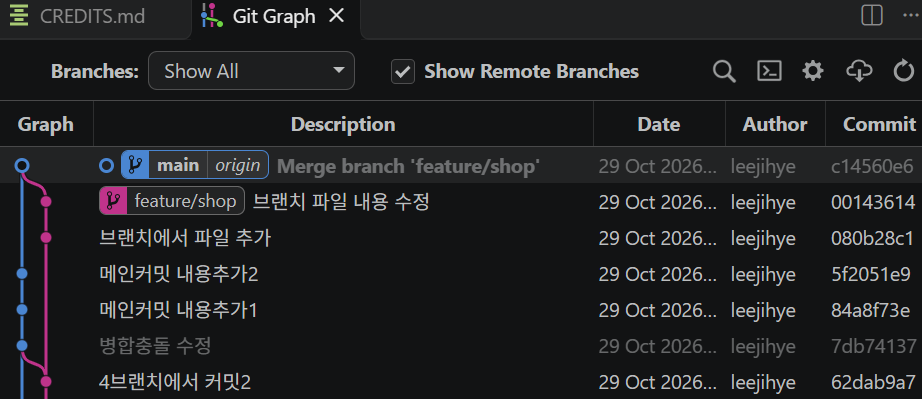
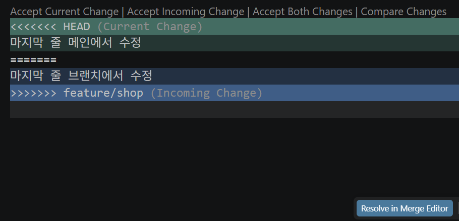

## 1️⃣ Git merge 복습

```sh
# main 커밋 1회 : main에서 README.md 파일 내용 수정

# 새 브랜치 생성 및 즉시 이동
$ git switch feature/shop

# branch 커밋 1회 : branch에서 CREDITS.md 파일 추가

# 메인으로 돌아가기
$ git switch main
```

<details>
<summary> 📌 [참고] git switch와 git checkout 비교하기 </summary>

| 구분 | `git switch main` | `git checkout main` |
|---|---|---|
| 브랜치 이동 | ✅ 가능 | ✅ 가능 |
| 브랜치 생성 + 이동 | ✅ `git switch -c feature` | ✅ `git checkout -b feature` |
| 특정 파일 복원 | ❌ 불가능 | ✅ 가능 |
| 특정 커밋으로 이동 | ❌ 일반적으로 불가능 | ✅ 가능 |
| 주요 목적 | **브랜치 전환에 특화** | 브랜치 전환 및 파일 복원 등 |
| 추천 | ⭐ 초보자에게 추천(역할이 단순, 명확) | 기존 Git 자료에서 자주 사용 |

</details>

<br>

```sh
# git graph에서 branch 상태 확인
$ git log --oneline --all --graph

# 메인에서 git merge로 브랜치 병합하기
$ git merge feature/shop

# 병합 커밋 메시지 작성 창(main 커밋 수준과 brach 커밋 수준이 동일할때 발생!!)
Merge branch 'feature/shop'
  Please enter a commit message to explain why this merge is necessary,
  especially if it merges an updated upstream into a topic branch.
  Lines starting with '#' will be ignored, and an empty message aborts
  the commit.
  📍 shift + A :  APPEND(최하단--INSERT--) 기능. 첫 줄 맨 뒤에 다른 내용 추가 작성 가능 
  📍 ESC 누른후 ':wq' 작성하여 빠져나오기

# main에서 feature/shop 브랜치를 병합하기
$ git merge feature/shop
Merge made by the 'ort' strategy. #ort 전략 : 
 README.md | 18 +-----------------
 1 file changed, 1 insertion(+), 17 deletions(-)$

# git grpah에서 branch 병합된 것 확인
$ git log --oneline --all --graph
*   c14560e (HEAD -> main, origin/main) Merge branch 'feature/shop'
|\  
| * 0014361 (feature/shop) 브랜치 파일 내용 수정
| * 080b28c 브랜치에서 파일 추가
* | 5f2051e 메인커밋 내용추가2

```
<br>

📌 [참고] git graph 확장팩 설치 : git graph 시각적 확인 가능  

  

<br>

## 2️⃣ branch merge conflict(개인 작업)

### 1. 충돌 상황 만들기 (앞 코드에 이어서)

- main, branch에서 똑같은 라인의 내용을 각각 다르게 수정

```sh
# 브랜치로 이동
$ git checkout feature/shop
Switched to branch 'feature/shop'

# 브랜치에 메인의 내용을 merge, main=brach 동일상태로 만들기
jihey@LAPTOP-T7TVDFIE UCRT64 ~/kant-study (feature/shop)
$ git merge main 

# 브랜치에서 마지막 라인의 내용을 수정, add, commit
jihey@LAPTOP-T7TVDFIE UCRT64 C:/Users/jihey/261029practice (feature/shop)
$ git commit -m "마지막 줄 브랜치에서 수정"

# main으로 이동
$ git checkout main

# main에서 마지막 라인의 내용을 수정, add, commit
jihey@LAPTOP-T7TVDFIE UCRT64 C:/Users/jihey/261029practice (main)
$ git commit -m "마지막 줄 메인에서 수정"

# main에서 브랜치 merge 시도
$ git merge feature/shop
AUTO-merging CREDITS.md # merge 오류 발생
CONFLIC (content) : Merge conflict in CREDITS.md
Automatic merge failed; fix conflicts and then commit the result.
```
🔽 작업 화면


- accept current change : head(main,초록색 부분) 수정사항을 선택 반영
- accept incoming change : featrure/shop(branch,파란색 부분) 수정사항을 선택 반영
- accept both changes : 수정사항들을 모두 반영(모두 살려서 적기)
하단의 resolve in merge editor는 잘 쓰지 않음

### 2. 충돌 해결하기

```sh
# 충돌 해결하기 
  1. 수동 방식 : 충돌 부분 삭제하여 해결
  2. 자동 방식 : 상단 선택지 중 1개 클릭 > both modified 뜸

# git status에서 both modified 상태 확인
$ git status
On branch main
You have unmerged paths.
  (fix conflicts and run "git commit")
  (use "git merge --abort" to abort the merge)

Unmerged paths:
  (use "git add <file>..." to mark resolution)
        both modified:   README.md

no changes added to commit (use "git add" and/or "git commit -a")

# 충돌 해결하여 수정된 상태를 최종적으로 add, commit 
$ git commit -m "병합 충돌 해결(수정) 완료"
[main d034fe3] 병합 충돌 해결(수정) 완료
```

#### 🚨 merge는 덮어쓰기, 롤백이 아니고 '변경 사항 합치는 작업'임을 확실히 이해!!

```sh
# main, brach가 양쪽에서 모두 merge 완료되어 동일한 상태에서 브랜치에만 내용을 추가
$ git commit -m "병합 상태에서 브랜치 또 수정"
[feature/shop 8d0b5a0] 병합 상태에서 브랜치 또 수정
 1 file changed, 3 insertions(+), 1 deletion(-)

# 브랜치에서 main을 merge하기
jihey@LAPTOP-T7TVDFIE UCRT64 C:/Users/jihey/261029practice (feature/shop)
$ git merge main

# 내 추측 : 앞서나간 branch에서 뒤처진 main을 merge하면,
# branch의 수정사항이 사라질 것이다 (x)

# 실제 : main brach의 수정내용이 branch에 합쳐지기만 하는 것.
# main에 수정사항이 없으니 branch는 최신 수정 상태에서 변화가 없는 상태로 유지됨!

# 내가 생각한 것은 git reset --hard main에 가깝다
- git merge main : 현재 브랜치에 main의 변경 사항 병합
- git reset --hard main : 현재 브랜치의 위치와 파일 상태를 main에 맞춤  
  (기존 변경 사항 손실 위험)
```
<br>

## 3️⃣ branch merge conflict(팀 작업)

### 1. 작업 환경 만들기
[팀장]
- 'kant-team' 폴더 생성 및 git 초기화
- github에서 private repo 생성
- local repo를 remote repo와 연결하기
- add commit 필수!!! 그 다음 로컬 리포 원격에 push
- 해당 repo의 settings > access > collaborators에서 팀원을 email로 add하기
- 팀장은 local에 README.md가 없는 상황이므로, github에서 repo 만들때 생긴 README.md 파일 가져오기 위해 터미널에서 git pull origin main 하기  
  - 이 과정이 없으려면, mkdir 하면서 echo, touch 등으로 README.md를 생성하고 push

[팀원]
- 이메일에서 accept invitation하여 repo에 참여
- repo url 복사, 터미널에서 각자의 로컬로 팀 repo를 git clone
- cd kant-team 로 이동, code . 으로 vscode 열기

➡️ 팀 전체 작업 환경 모두 동일해진 상태

### 2. 충돌없이 작업해보기
[팀원 A]
- 내용을 수정하고 commit, git push origin main하기
[나머지 팀원]
- git pull origin main : 팀원A 가 수정하고 github push한 내용을 로컬로 가져옴  
    - [참고] git fetch(다운로드만) + merge(병합만) = git pull(다운로드 및 병합)

### 3. 충돌 시나리오(1)
[팀장, 팀원 A]
- README.md 파일 같은 줄 내용을 수정 후 커밋, 팀장이 먼저 push
- 이후 팀원이 push 시도 > 에러 발생 > pull 실행
- merge conflict 충돌 발생 > 수정 후 commit, push

### 4. 충돌 시나리오(2)
- 팀원별 자신의 성명 이니셜 파일 생성 (예, LJH.md)
- 팀장이 먼저 커밋 후 원격 리포에 push
- 나중에 push 하는 팀원은 오류 발생 > git pull 실행 후 다시 push
- 모든 팀원의 이니셜 파일 공유됨을 확인

  🚨 혹시 팀원끼리 이니셜이 겹쳐 파일 이름이 똑같다면?  
      파일 이름을 똑같이 쓰면, 각각 다른 사람들이 올렸어도 같은 파일로 인식됨.  
      즉, 먼저 push 성공한 팀원의 이니셜 파일에 나중에 push한 사람의 내용이 덮어쓰기 됨!


- pull 받으며 merge가 뜰 때(?)는 이 부분을 확인해보자!
```sh
# git config 설정 리스트 확인
$ git config --list
pull.rebase=false # <-- pull 설정 찾기

# pull.ff 설정으로 바꾸기
$ git config --global pull.ff yes
```
<br>

<details>
<summary> 📌[참고] 타인의 git을 clone하고, 내 remote repo로 연결해 쓰려면? </summary>

[문제 상황]
- 개인 실습을 수업 중 사용하는 파일에서 하다보니 튜터님이 보여주시는 파일과 내용이 너무 달라져 버림. 튜터님의 파일을 그대로 받아와 내 remote repo에 push하며 사용하고 싶다!

[방법]
1. git clone 해오기
- [터미널] git clone + 가져올 URL 입력해서 로컬로 가져오기
  🚨기존에 이미 똑같은 이름의 폴더/파일이 있다면? : mv + 기존 이름 + 새 이름으로 변경 후 git clone 다시 하기
    mv kant-study _kant-study (기존 폴더를 다른 이름으로)

2. git origin 연결 수정하기
- [vscode 터미널] git remote -v 로 연결상태 확인 : 튜터님의 repo가 origin으로 등록되어 있음
  🚨 기존 origin 수정, 변경은 불가! 기존 origin을 삭제하고 새로 등록해야 함
- git remote remove origin 으로 기존 origin 삭제
- git remote add origin + 내 repo URL로 새 origin 등록
  -> 이제부터 내 remote repo로 push하며 쓸 수 있다!

</details>