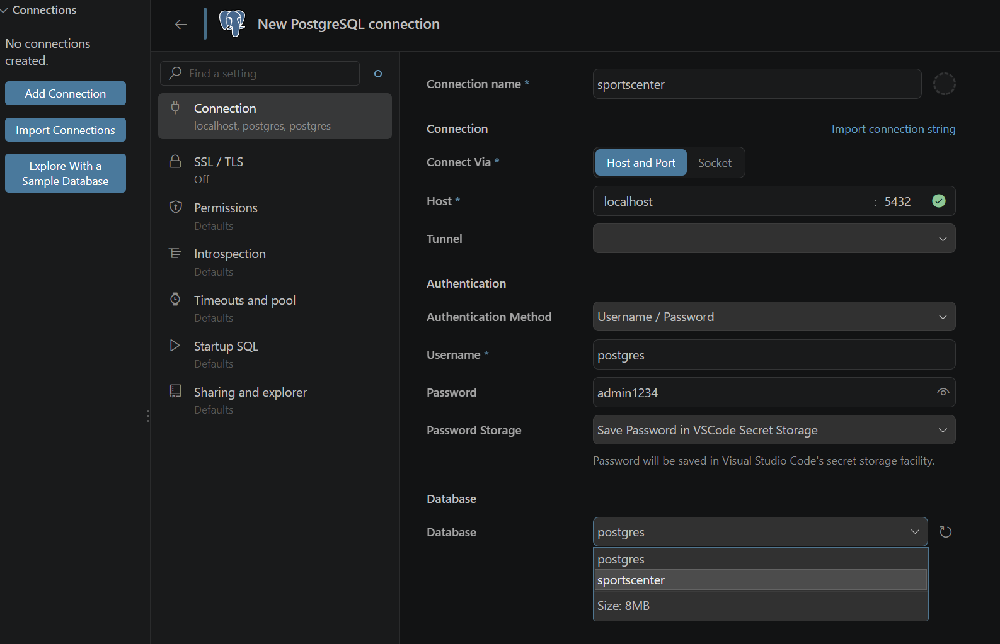

# 01 [데이터베이스] 개념과 활용 기초
## 1️⃣ 데이터베이스 개념

### 1. DB와 RDBMS

### 3. RDBMS가 갖는 무결성, 트랜잭션, 성능 최적화 측면의 장점

#### (1) 무결성: 잘못된 데이터가 들어오는 것 막음, 규칙을 걸어 데이터가 일관된 형태를 유지하도록 함
- 기본 키(PK, primary key): 각 행을 고유하게 식별
- 외래 키(FK, foreign key): 존재하지 않는 대상과의 관계가 생기는 것 방지  
  (ex:없는 회원의 주문 저장 방지)
- 제약 조건: NOT NULL, UNIQUE, CHECK 등으로 필수 값이나 허용 범위를 강제
📍 이 규칙들은 여러 프로그램이 같은 DB에 접근해도 공통으로 적용

#### (2) 트랜잭션: 여러 작업을 하나의 안전한 단위로 처리  
(ex : A 계좌에서 돈을 빼고 B 계좌에 넣는 작업은 둘 다 성공하거나 둘 다 취소되어야 함,  
 RDBMS는 이를 ACID 속성으로 지원)
- A(Atomicity) 원자성: 트랜잭션의 작업이 모두 반영되거나 모두 취소
- C(Consistency)일관성: 트랜잭션이 정의된 제약 조건을 지키며 데이터를 변경
- I(Isolation) 격리성: 동시 실행되는 트랜잭션이 서로 간섭하지 않도록 격리 수준에 맞게 제어
- D(Durability) 지속성: 성공적으로 확정된 변경은 장애가 나도 유지되도록 보장
📍이를 위해 잠금, MVCC, 로그와 복구 같은 엔진 기능을 활용

#### (3) 성능 최적화: 데이터를 찾고 처리할 방법을 스스로 선택
- RDBMS에는 SQL을 실행하기 전에 여러 처리 방법을 비교하는 쿼리 옵티마이저가 존재
- 쿼리 옵티마이저는 데이터의 양과 분포, 인덱스 등을 고려해 실행 계획을 선택

## 2️⃣ 데이터베이스 생성 및 데이터 추가

### 1. 기초 환경 설정 

#### (1) 프로젝트 파일 생성 및 VScode로 열기
```sh
cd kant_study/02_database/
mkdir SportsCenter
cd SportsCenter/
code .
```

#### (2) docker, docker compose 설치 확인 후 엔진 실행
- docker 엔진 실행 방법 : (windows) docker desktop 오픈 / (mac) colima start
```sh
# docker, compose 설치 상태 확인 후 엔진 실행
docker --version
docker compose version
# 엔진 실행 후
docker info # 엔진 연결 오류 확인(서버정보 출력시 엔진 연결 완료)
```

### 2. compose 파일 작성 및 컨테이너 실행

#### (1) docker-compose.yaml 파일 작성 (compose.yaml과 같이 인식)
- docker compose가 기본적으로 인식가능한 파일명으로 compose 파일 생성 :  
  compose.yaml(권장) == compose.yml == docker-compose.yaml(혹은 .yml)   
  ** 다른것 임의로 지정하고 싶다면 명령어에 파일 이름을 지정해서 실행해야 함! 불편..

- 문법에 따라 compose 파일 내용 작성
```sh
# 생활체육 회원관리 실습용 PostgreSQL
name: sportscenter # docker compose 이름(사실상 프로젝트명)
services:
  db: # 서비스 이름 db
    container_name: sportscenter-db # 컨테이너 이름
    image: postgres:18 # 이미지 이름
    environment: # 환경변수 목록
      POSTGRES_PASSWORD: admin1234 # 비밀번호 변수 
    ports:
      - "5432:5432" # 포트 번호
    volumes:
      - pgdata:/var/lib/postgresql # 볼륨 연결 설정 (볼륨명 : 컨테이너 내 고정 경로)
        # 아래 정의한 pgdata 볼륨을 db컨테이너의 /var/~ 경로에 연결하겠다
volumes:
  pgdata: # 볼륨 정의/ 준비
  # compose 프로젝트에서 pgdata라는 이름의 볼륨을 사용하겠다
  # 별도 설정이 없으면 compose가 실행할 때 필요한 볼륨을 직접 만듦
```

#### (2) compose 파일에 정의된 서비스대로 postgres 실행
- docker compose up 을 하면 무슨 일이 일어날까?
  - compose가 .yaml 파일을 읽고 서비스의 설정을 확인
  - 설정 내 이미지, 볼륨, 네트워크 준비(없으면 자체 생성)
  - 해당 이미지로 컨테이너 만들고 실행
  - 컨테이너 안에서 서버 프로그램(ex:postgres) 실행
```sh
docker compose up -d # 백그라운드에서 실행
```
> [참고]  
> - compose 프로젝트 서비스(컨테이너) 중지 : docker compose stop  
> - 삭제 : docker compose down  
> - (재)시작 : docker compose start


#### (3) 볼륨, 컨테이너 생성 상태 확인
- compose가 생성한 <프로젝트명 + 볼륨명> 볼륨 확인 (ex: sportscenter-pgdata)
  - 서로 다른 프로젝트가 같은 이름의 볼륨을 사용하는 것을 막기 위해 설정됨
- Vscode 좌측 Containers(아이콘) > Volumes > 해당 볼륨 우클릭 > Inspect에서 볼륨의 상세 정보 확인

```sh
docker volume ls # sportscenter-pgdata 볼륨 확인
docker compose ps # 컨테이너 확인
# [참고] ports의 0.0.0.0는 어느 ip든 접속을 허용한다는 의미임
```

### 3. 컨테이너 내부에서 DB 작업하기

#### (1) 컨테이너 접속 및 기본 설정

- Compose로 컨테이너 접속 : docker compose exec <서비스명> <실행할 프로그램/명령어> <명령어 옵션>
```sh
docker compose exec db psql -U postgres
# db 서비스를 실행, 서비스 해당 컨테이너에서 psql 실행, 명령어 유저 옵션 postgres
```

- postgres 접속 정보 확인
```sql
postgres=# SELECT version();  # 현재 접속한 postgres 서버 버전, 환경정보 확인
-- 출력 결과 : PostgreSQL 18.6 (Debian 18.6-1.pgdg13+2) on x86_64-pc-linux-gnu,  
-- compiled by gcc (Debian 14.2.0-19) 14.2.0, 64-bit
```

- 해당 postgres 서버 데이터베이스 목록 확인
```sh
postgres-# \l # DB 리스트 확인
```

- SQL문 모아서 저장할 .sql 확장자 파일 만들기 (ex: sportscenter_study.sql)

#### (2) DB 만들기

- sportscenter DB 생성 SQL
```sql
CREATE DATABASE sportscenter; # 데이터베이스 생성 후 \l로 생성 확인
```

- DB 접속하기 (\c)
```SH
postgres=# \c sportscenter # \c(connect) + 데이터베이스 이름
# You are now connected to database "sportscenter" as user "postgres".
```

- DB Code 사용을 위해 postgres 서버 연결
좌측 아이콘 DBcode 들어가서 'add connection' 클릭, 사진과 같이 설정


#### (3) DB안에 테이블 만들기

- (docker compose stop 되어있다면) start, sportscenter 데이터베이스 접속
```sh
docker compose start
docker compose exec db psql -U postgres -d sportscenter
```

- members 테이블 생성 SQL문 작성 및 실행
```sql
CREATE TABLE members 
(
    member_id   SERIAL  PRIMARY KEY,
    name        VARCHAR(20) NOT NULL,
    gender      CHAR(1)     NOT NULL,
    birth_year  SMALLINT    NOT NULL,
    phone       VARCHAR(20),
    email       VARCHAR(50),
    region      VARCHAR(10),
    joint_date  DATE        NOT NULL
);
-- [참고] Tab으로 단어간 간격 맞출 수 있음
```

- 테이블 생성 상태 확인하기
```SQL
\dt : 접속 중인 데이터베이스의 테이블 목록 확인
\d 테이블명 : 해당 테이블의 열, 데이터 타입, 빈값 허용 여부 등 확인 가능
SELECT * FROM 테이블명 : 테이블 내용 확인 
-- DBCode에서도 table, sequence 생성 확인 가능(반영 안되면 disconnect 후 재연결(refresh))
```

#### (4) 테이블에 자료 입력하기

```text
[다양한 INSERT 작성 형식]
📍 기본 형태 : INSERT INTO 테이블 VALUES 추가할 값들

1. 전체 컬럼에 값 추가
INSERT INTO 테이블명 VALUES (모든 컬럼, , , ,);

2. 일부 컬럼 지정해서 값 추가
INSERT INTO 테이블명 (컬럼1, 컬럼2, 컬럼3) VALUES (컬럼1값, 컬럼2값, 컬럼3값);

3. 조회 결과를 추가
INSERT INTO 테이블명 SELECT * FROM WHERE 조건;

4. 여러 행을 한 번에 추가
INSERT INTO 테이블명 (컬럼1, 컬럼2, 컬럼3)
VALUES
(컬럼 1값, 2값, 3값),
(컬럼 1값, 2값, 3값),
(컬럼 1값, 2값, 3값),
(컬럼 1값, 2값, 3값);
```

- 회원 데이터 추가 SQL
```sql
-- 회원 추가 1
-- 참고 : 가독성을 위해 한줄씩 줄바꿈하여 적을 수 있음
INSERT INTO members 
(
    name,
    gender,
    birth_year,
    phone,
    email,
    region,
    join_date
)
VALUES
(
    '김하늘',
    'F', 
    1995, 
    '010-1234-5678', 
    'haneul@example.com', 
    '마포구', 
    '2026-09-01'
);

-- 회원 추가 2
INSERT INTO members (name, gender, birth_year, phone, email, region, join_date)
VALUES ('이준호', 'M', 1988, '010-2345-6789', NULL, '서대문구', '2026-09-03')
```

#### (5) 데이터 조회

- 테이블 전체 조회하기
```SQL
sportscenter=# SELECT * FROM members;
-- 출력 결과
 member_id |  name  | gender | birth_year |     phone     |       email        |  region  | join_date  
-----------+--------+--------+------------+---------------+--------------------+----------+------------
         1 | 김하늘 | F      |       1995 | 010-1234-5678 | haneul@example.com | 마포구   | 2026-09-01
         2 | 이준호 | M      |       1988 | 010-2345-6789 |                    | 서대문구 | 2026-09-03
```

- 일부 칼럼만 선택하여 조회하기
  - 데이터 규모가 커질수록 필요한 칼럼만 찾아서 빠르게 조회하는 것도 중요 ⭐
```sql
sportscenter=# SELECT name, region FROM public. members; --default 스키마(public.) 생략 가능

-- 출력 결과
  name  |  region  
--------+----------
 김하늘 | 마포구
 이준호 | 서대문구
(2 rows)
```

## 3️⃣ 외래키 활용

### 1. 외래키 개념

### 2. 외래키 활용

#### (1) 참조가 될 테이블 작업

- 강좌 목록 테이블 생성 및 데이터 추가, 확인

> [참고] 컬럼명 작명 규칙?  
> 다른 테이블까지 조인하여 같이 봐야하는 경우도 고려,  
> sports_id 처럼 테이블명 명시해주면 좋음! 컬럼명만 보고도 출처 쉽게 알 수 있음!

```sql
-- sports 테이블 생성 및 데이터 추가
CREATE TABLE sports
(
    sports_id   SERIAL      PRIMARY KEY,
    sport_name VARCHAR(20) NOT NULL
);

INSERT INTO sports (sport_name) VALUES ('수영');
INSERT INTO sports (sport_name) VALUES ('헬스');

-- 테이블 생성(목록) 확인
sportscenter=# \dt
           List of tables
 Schema |  Name   | Type  |  Owner   
--------+---------+-------+----------
 public | members | table | postgres
 public | sports  | table | postgres

-- 테이블 데이터 확인
sportscenter=# SELECT * FROM sports;
 sports_id | sport_name 
-----------+------------
         1 | 수영
         2 | 헬스
```

#### (2) 참조할(외래키 사용할) 테이블 작업

- 개설 강좌 테이블 생성 및 데이터 추가, 확인
```sql
-- courses 테이블 생성
CREATE TABLE courses
(
    course_id   SERIAL      PRIMARY KEY,
    sports_id   INT         NOT NULL REFERENCES sports (sports_id),
    -- sports 테이블의 sports_id를 외래키로 사용
    -- 즉, sports > sports_id 값들만 courses > sports_id 값으로 들어갈 수 있다! ⭐ 
    course_name VARCHAR(30) NOT NULL,
    level       VARCHAR(10) NOT NULL,
    class_days  VARCHAR(10) NOT NULL,
    start_time  TIME        NOT NULL,
    capacity    SMALLINT    NOT NULL,
    fee         INT         NOT NULL
);

-- 데이터 추가
INSERT INTO courses (sports_id, course_name, level, class_days, start_time, capacity, fee)
VALUES (1, '수영 초급 새벽반', '초급', '월수금', '06:00', 20, 70000);
INSERT INTO courses (sports_id, course_name, level, class_days, start_time, capacity, fee)
VALUES (2, '헬스 자유이용', '자유', '매일', '06:00', 50, 50000);

-- 테이블 생성(목록) 확인
sportscenter=# \dt
           List of tables
 Schema |  Name   | Type  |  Owner   
--------+---------+-------+----------
 public | courses | table | postgres
 public | members | table | postgres
 public | sports  | table | postgres

-- 테이블 데이터 확인
sportscenter=# SELECT * FROM courses;
 course_id | sports_id |   course_name    | level | class_days | start_time | capacity |  fee  
-----------+-----------+------------------+-------+------------+------------+----------+-------
         1 |         1 | 수영 초급 새벽반 | 초급  | 월수금     | 06:00:00   |       20 | 70000
         2 |         2 | 헬스 자유이용    | 자유  | 매일       | 06:00:00   |       50 | 50000
```

[참고] 외래키 오류
```sql
-- sports_id로, sports 테이블에 없는 값(1,2 제외 나머지 값, 여기서는 30)을 넣으면 외래키 오류 발생
sportscenter=# INSERT INTO courses (sports_id, course_name, level, class_days, start_time, capacity, fee)
VALUES (30, '헬스 자유이용', '자유', '매일', '06:00', 50, 50000);
-- ERROR:  insert or update on table "courses" violates foreign key constraint "courses_sports_id_fkey"
-- DETAIL:  Key (sports_id)=(30) is not present in table "sports"
```

#### (3) 데이터 삭제 (DELETE, CASCADE)

- DELETE FROM : 테이블 행을 삭제, 단, 그 행을 참조하는 다른 데이터들이 존재하면 삭제 불가
```sql
DELETE FROM sports WHERE sports_id = 1
--ERROR:  update or delete on table "sports" violates foreign key constraint  
--"courses_sports_id_fkey" on table "courses"
```

- ON DELETE CASCADE : 외래키가 참조하는 행이 삭제될 때, 그 행을 참조하던 다른 행도 함께 삭제  
  -> 외래키 제약 조건 발생되지 않고 바로 데이터가 삭제됨

```sql
-- 사물함 테이블 생성
CREATE TABLE lockers
(
    locker_no   INT     PRIMARY KEY,
    member_id   INT     NOT NULL    UNIQUE  REFERENCES members (member_id) ON DELETE CASCADE,
    -- UNIQUE: 한 회원이 여러개 락커 할당받지 못하도록, 즉, member_id 중복값 제한
    -- members 테이블에서 member_id가 삭제(회원탈퇴)되면, lockers 테이블의 해당 member_id 행도 삭제
    asign_date  DATE    NOT NULL
);

-- 삭제용 임시회원 추가
INSERT INTO members (name, gender, birth_year, join_date)
VALUES ('임시회원', 'M', 2000, '2026-11-01');
SELECT member_id, name FROM members;

-- 사물함 이용 데이터 추가(사물함 배정)
INSERT INTO lockers VALUES (101, 1, '2026-11-01'); -- 정상 처리
INSERT INTO lockers VALUES (102, 1, '2026-11-01'); -- member_id 중복으로 오류 발생, 처리X
--ERROR :  duplicate key value violates unique constraint "lockers_member_id_key"
--DETAIL:  Key (member_id)=(1) already exists.
INSERT INTO lockers VALUES (102, 3, '2026-11-01'); -- 정상 처리

-- 테이블 데이터 확인
SELECT * FROM lockers;
 locker_no | member_id | asign_date 
-----------+-----------+------------
       101 |         1 | 2026-11-01
       102 |         3 | 2026-11-01

-- 회원 테이블에서 임시회원 데이터 삭제
DELETE FROM members WHERE member_id = 3;

-- 사물함 테이블의 임시회원 데이터도 삭제된 것 확인
SELECT * FROM lockers;
 locker_no | member_id | asign_date 
-----------+-----------+------------
       101 |         1 | 2026-11-01
```

[참고] 데이터 중복 오류(무결성 원칙 위배) - 기본키 id 중복 추가 시도
```sql
-- member_id가 1인 회원이 있는 상태에서 같은 번호로 다른 회원을 추가하려고 할 때,
INSERT INTO members (member_id, name, gender, birth_year, join_date)
VALUES (1, '이재현', 'M', 2010, '2025-01-01');
-- ERROR:  duplicate key value violates unique constraint "members_pkey"
-- DETAIL:  Key (member_id)=(1) already exists.
-- member_id가 SERIAL로 설정되어있다면 충돌 방지를 위해 생략!
```
