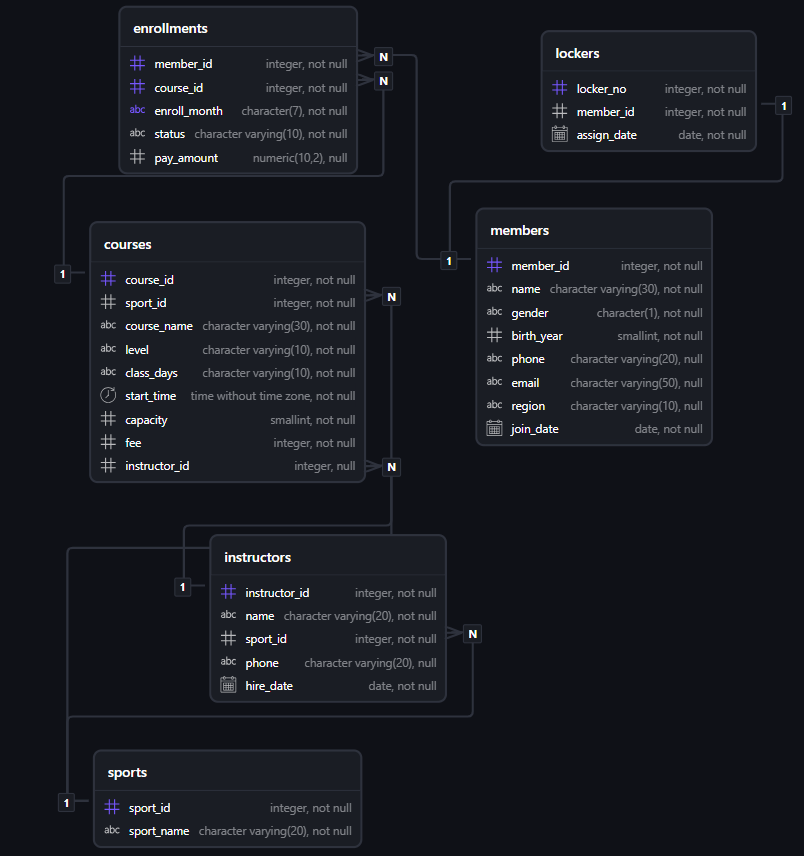

# 01 [데이터베이스] DB 변경, Seed 파일 활용, 데이터 조회

## 🔽 과제 피드백
- DROP ~ IF EXISTS ~
- NUMERIC~ DEFAULT 0 CHECK(price >=0) *check로 제약조건 확인가능
  - 하단에 CONSTRAINT로 따로 뺼 수 있음 

```SQL
CONSTRAINT fk_product_category -- 객체명 설정
    FOREIGN KEY (category_id)
    REFERENCES category (category_id), -- 마지막 constraint 나올때까지 , 처리
-- 나눠쓸 때 두줄 다 다 써줘야 함


-- 제약조건(가격 >=0)
CONSTRAINT chk_products_price
    CHECK (price >= 0),

-- 유니크도 아래에 따로 뺄 수 있음
CONSTRAINT uq_carts_user_product
    UNIQUE (user_id, product_id)
```


## 1️⃣ 자료형, 테이블 생성, 자료 추가 복습

### 1. 자료형

#### (1) 문자 자료형
| 자료형 | 의미 | 저장할 값 예시 | 활용 예시 |
|---|---|---|---|
| `CHAR(n)` | 고정 길이 문자열. 짧으면 뒤를 공백으로 채움 | `'M'` | 한 글자 상태 코드 |
| `VARCHAR(n)` | 최대 `n`글자의 가변 길이 문자열 | `'이지혜'` | 이름, 전화번호, 이메일 |
| `TEXT` | 별도 최대 길이를 지정하지 않은 문자열 | `'오늘 배운 SQL 내용 정리'` | 메모, 게시글 본문, 상품 설명 |

<details> <summary> [추가 참고] 문자열 CHAR와 VARCHAR 비교 </summary>

1. CHAR vs VARCHAR

- 공통점 : CHAR, VARCHAR는 둘 다 문자열 자료형(이름, 전화번호, 상품 코드 등 문자 저장)
  - (최대) 길이 지정 가능, postsql에서 VARCHAR, CHAR(n) 안의 n은 바이트가 아니라 문자수를 기준으로 함!
  - 참고로 전화번호는 숫자 자료긴 하지만 계산에 안쓰고, 앞의 0이나 -를 유지해야 하므로 문자로 저장

- 차이점 : 지정한 길이(최대 길이)보다 짧은 값을 넣었을 때 빈자리를 어떻게 처리하는지가 달라짐
  - CHAR : 고정 길이, 남는 자리에 공백을 채워 지정 길이 맞춤
  - VARCHAR : 가변 길이, 즉, 짧은 값을 있는 그대로 저장

| 구분 | `CHAR(5)` | `VARCHAR(5)` |
|---|---|---|
| 의미 | 고정 길이 문자 | 가변 길이 문자 |
|사용법|(다른 시스템과 연동 등) 공백 포함한 고정 폭 형식 필요시|값의 길이가 일정하지 않지만 최대 길이를 제한하고 싶을 때|
| 최대 길이 | 5글자 | 5글자 |
| `ABC` 입력 시 | 뒤에 공백을 채워 5글자에 맞춤 (ex: ABC□□) | 입력한 3글자를 그대로 저장 (ex: ABC) |
| 5글자 초과 | 일반적으로 오류 | 일반적으로 오류 |

2. 활용 방식

- 단, 고정 길이라고 무조건 CHAR를 써야 하는 것 아님, PostgreSQL에서는 CHAR에 그런 성능상 이점이 없고,  
  오히려 공백을 채우는 만큼 공간과 처리 비용이 더 들 수 있으므로 VARCHAR나 TEXT를 권장 (공식 문서)

- 보통 정확히 두 글자만 입력받고 싶다면 VARCHAR(n)에 CHECK 제약 조건을 추가
```SQL
CREATE TABLE countries (
    country_code VARCHAR(2) NOT NULL
        CHECK (char_length(country_code) = 2) -- 정확히 2글자만 입력되도록 통제
);
```

- 상황별 활용례
| 상황 | 선택 예시 |
|---|---|
| 이름: 최대 30글자 | `VARCHAR(30)` |
| 나라 코드: 정확히 2글자 | `VARCHAR(2)` + `CHECK` |
| 긴 메모: 별도 길이 제한 없음 | `TEXT` |
| 공백으로 채우는 고정 폭 형식이 필요함 | `CHAR(n)` |

</details>

#### (2) 정수 자료형
| 자료형 | 의미 | 저장할 값 예시 | 활용 예시 |
|---|---|---:|---|
| `SMALLINT` | 비교적 작은 범위의 정수 | `1998` | 출생연도, 소량의 재고 |
| `INTEGER` 또는 `INT` | 일반적인 정수 | `15000` | 원화 금액, 수량, 나이 |
| `BIGINT` | 큰 범위의 정수 | `5000000000` | 매우 큰 금액, 대량의 조회 수 |

#### (3) 소수점이 있는 숫자 자료형
| 자료형 | 의미 | 저장할 값 예시 | 활용 예시 |
|---|---|---:|---|
| `NUMERIC(p, s)` | 자릿수를 지정하는 **정확한 십진수** | `123.45` | 금액, 정확도가 필요한 계산 |
| `REAL` | 소수점이 있는 **근삿값** | `36.7` | 온도 등 측정값 |
| `DOUBLE PRECISION` | `REAL`보다 더 정밀한 근삿값 | `3.1415926535` | 과학·통계 계산 |

#### (4) 날짜와 시간 자료형
| 자료형 | 의미 | 저장할 값 예시 | 활용 예시 |
|---|---|---|---|
| `DATE` | 날짜: 연·월·일 | `'2026-11-17'` | 생년월일, 가입일 |
| `TIME` | 시간: 시·분·초 | `'14:30:00'` | 강좌 시작 시간 |
| `TIMESTAMP` | 날짜 + 시간, 시간대 없음 | `'2026-11-17 14:30:00'` | 시간대를 따로 고려하지 않는 일정 |
| `TIMESTAMPTZ` | 시간대를 고려하는 날짜와 시간 | `'2026-11-17 14:30:00+09'` | 가입·결제 등 실제 발생 시각 |

#### (5) 참, 거짓 자료형
| 자료형 | 의미 | 저장할 값 예시 | 활용 예시 |
|---|---|---|---|
| `BOOLEAN` | 참 또는 거짓 | `TRUE`, `FALSE` | 활성 회원 여부, 출석 여부 |

#### (6) 자동번호
| 자료형처럼 쓰는 표현 | 의미 | 저장할 값 예시 | 활용 예시 |
|---|---|---|---|
| `SERIAL` | 정수 컬럼과 자동 번호 생성을 설정 | `1`, `2`, `3`… | 회원 번호, 게시글 번호 |
| `BIGSERIAL` | 더 큰 범위의 자동 번호를 설정 | 큰 정수 번호 | 데이터가 매우 많이 쌓이는 ID |


### 2. 테이블 생성 및 자료 추가

#### (1) 사전 작업
```text
1. docker desktop 가동
2. docker, docker compose 상태 확인
3. docker compose start로 프로젝트 compose파일 실행 > 컨테이너 재시작
4. docker compose logs db / docker volume ls로 로그와 볼륨 상태 확인
4. docker compose exec db psql -U postgres -d sportscenter로 DB 접속
```

#### (2) 테이블 생성 및 자료 추가

- 수강신청 테이블 생성, 신청 목록 추가
  - 여러 컬럼을 묶어서 PRIMARY KEY 지정 가능! ⭐
    (ex) member_id, course_id, enroll_month 모두 일치하는 중복 데이터는 있을 수 X

```SQL
CREATE TABLE enrollments
(
    member_id       INT            NOT NULL    REFERENCES members (member_id),
    course_id       INT            NOT NULL    REFERENCES courses (course_id),
    enroll_month    CHAR(7)        NOT NULL,
    status          VARCHAR(10)    NOT NULL,
    pay_amount      NUMERIC(10,2)  NOT NULL CHECK (pay_amount>=0), --여기에 콤마 필요! 마지막 줄 아님⭐
    PRIMARY KEY (member_id, course_id, enroll_month)
);

-- 데이터 추가
INSERT INTO enrollments
VALUES (1, 1, '2026-11', '수료', 50000);

INSERT INTO enrollments
VALUES (2, 2, '2026-10', '수료', 70000);

-- Duplicate key (pk 충돌) 오류 확인
INSERT INTO enrollments
VALUES (2, 2, '2026-10', '수료', 60000);
```


## 2️⃣ 관계와 ERD

### 1. 개념
- ERD(Entity Relationship Diagram) : DB 내 관계와 필요한 정보를 한눈에 보여주는 설계도  
  어떤 테이블이 필요한지, 각 테이블에 어떤 컬럼을 둘지와 테이블 연결 등을 확인할 수 있음

### 2. DBCode를 통한 ERD 확인
- DBCode > 해당 스키마 TABLES 우클릭 refresh > 다시 우클릭 ERD 확인 > 각 테이블 refresh  
  => 스키마 내 테이블 간의 관계(ex: 참조 관계, 1:N / 1:1 관계 등)를 가시적으로 볼 수 있음


## 3️⃣ DB(테이블) 변경하기

### [개념] 테이블 변경(+삭제) 명령어

- 테이블명 수정 : ALTER TABLE 기존 이름 / RENAME TO 새 이름;
```sql
ALTER TABLE instructors
RENAME TO instructor; 
```

- 컬럼명 수정 : ALTER TABLE 테이블명 / RENAME COLUMN 기존 컬럼명 TO 새 컬럼명;
```SQL
ALTER TABLE members
RENAME COLUMN sport_id TO sports_id;
```

- 컬럼 추가 : ALTER TABLE 테이블명 / ADD COLUMN 새 컬럼명 + 자료형;
```SQL
ALTER TABLE courses
ADD COLUMN instructor_id INT REFERENCES instructor (instructor_id);
```

- 컬럼 삭제 : ALTER TABLE 테이블명 / DROP COLUMN 컬럼명;
```SQL
ALTER TABLE courses
ADD COLUMN instructor_id;
```

- 컬럼 자료형 수정 : ALTER TABLE 테이블명 / ALTER COLUMN 컬럼명 TYPE 새 자료형;
```SQL
ALTER TABLE members
ALTER COLUMN hire_date TYPE DATE;
```

- 컬럼 기본값 지정/해제(SET/DROP) : ALTER TABLE 테이블명 / ALTER COLUMN 컬럼명 / SET or DROP DEFAULT;
```SQL
ALTER TABLE members
ALTER COLUMN status SET DEFAULT 'active';

ALTER TABLE members
ALTER COLUMN status DROP DEFAULT;
```

- NOT NULL 추가/해제(SET/DROP) : ALTER TABLE 테이블명 / ALTER COLUMN 컬럼명 / SET or DROP NOT NULL;
```SQL
ALTER TABLE members
ALTER COLUMN member_name SET NOT NULL;

ALTER TABLE members
ALTER COLUMN member_name DROP NOT NULL;
```

[+참고] 삭제 명령어 정리 (DELETE, TRUNCATE, DROP의 차이)
- DATABASE와 TABLE은 DROP으로 삭제, 데이터 행은 DELETE로 삭제 
- TRUNCATE은 테이블을 빈 상태로 만들어준다는 점에서 조건없는 DELETE FROM과 같지만,
  대량의 데이터를 전부 비울 때는 TRUNCATE가 더 빠르며, SERIAL 초기화 등 옵션도 가능
  (ex: TRUNCATE TABLE members RESTART IDENTITY; -> 테이블 비우고 SERIAL 번호 초기화)

| 명령어 | 삭제 내용 | 테이블 구조 |
|---|---|---|
| `DELETE FROM members WHERE ...;` | 조건에 맞는 **행** 삭제 | 유지 |
| `DELETE FROM members;` | 모든 **행** 삭제(행 단위 처리) | 유지 |
| `TRUNCATE TABLE members;` | 테이블 안의 데이터 한번에 삭제 | 유지 |
| `DROP TABLE members;` | 테이블과 그 안의 데이터 삭제 | 삭제 |
| `DROP DATABASE sportscenter;` | DB 전체 삭제 | DB와 함께 삭제 |

### [실습] 기존 테이블에 column 추가하기

- 강사(instructors) 테이블 생성 및 데이터 추가
```sql
CREATE TABLE instructors
(
    instructor_id   SERIAL      PRIMARY KEY,
    name            VARCHAR(20) NOT NULL,
    sports_id        INT NOT NULL REFERENCES sports (sports_id), --not null!!
    phone           VARCHAR(20),
    hire_date       DATE    NOT NULL
);

INSERT INTO instructors (name, sports_id, phone, hire_date)
VALUES
('홍길동', 1, '010-1234-1234', '2026-01-01'),
('손흥민', 2, '010-1234-8080', '2026-01-10');
```

- 기존 강좌(courses) 테이블에 강사 테이블의 강사 아이디(instructor_id) 열 추가
```sql
ALTER TABLE courses
ADD COLUMN instructor_id INT REFERENCES instructor (instructor_id);
```

## 4️⃣ SEED 파일로 DB 작업 및 데이터 조회

### 1. 로컬의 seed 파일을 서비스 컨테이너에 복사하기
```SH
docker compose cp sportscenter_seed.sql db:/tmp/sportscenter_seed.sql
# sportscenter_seed.sql이름으로 저장
# 원본이름이랑 같은 이름으로 저장할거면 생략 후 tmp/까지만 작성
```

### 2. 데이터베이스 접속, 파일 목록 확인
```SH
# db 서비스 컨테이너의 sportscenter 데이터베이스 접속
docker compose exec db psql -U postgres -d sportscenter

# 컨테이너 저장 폴더(tmp) 내 파일 목록 확인
docker compose exec db ls /tmp
```

### 3. 컨테이너 저장소의 seed 파일을 데이터베이스에 import
```sh
sportscenter=# \i /tmp/sportscenter_seed.sql 
# \i : psql이 지정된 파일을 읽어서 그 안의 SQL 명령을 실행하는 명령어
# \dt 확인했는데 테이블 일부가 없는 등 오류 날 경우 컨테이너 접속 끊고 다시 start 해보기
```

### 4. 데이터 조회

#### (1) 데이터 전체/일부 조회 : LIMIT
```SQL
SELECT * FROM members; -- 전체 자료 조회(상하키로 스크롤 가능)
SELECT * FROM members LIMIT 5; -- 상위 5개 자료만 조회
```

#### (2) AS(alias, 별칭) 활용하여 조회
- AS로 별칭 설정시, 해당 쿼리를 실행하는 동안 조회 결과에 이름을 붙여 확인할 수 있음
  - COLUMN 이름이 바뀌거나 새 COLUMN이 만들어지는 것은 아님, 그냥 열람을 위한 제목
```sql
-- courses 테이블에서 상위 5개 조회하는데, course_name 열은 '강좌명' 열로,
-- fee 열은 '수강료' 열로, fee열 값에 3 곱한 값은 "3개월 수강료"열로 보기
SELECT course_name AS 강좌명,
fee AS 수강료,
fee * 3 AS "3개월수강료"
FROM courses
LIMIT 5;

-- 출력 결과
      강좌명      | 수강료 | 3개월수강료 
------------------+--------+-------------
 수영 초급 새벽반 |  70000 |      210000
 헬스 자유이용    |  50000 |      150000
 수영 중급 저녁반 |  75000 |      225000
 수영 상급 저녁반 |  80000 |      240000
 아쿠아로빅       |  65000 |      195000
```

#### (3) 중복없이 데이터 조회 : SELECT DISTINCT
```sql
-- members 테이블에서 region(지역)만 중복없이 조회
SELECT DISTINCT region FROM members;

-- 출력 결과
  region  
----------
 마포구
 영등포구
 용산구
 은평구
 서대문구
```

#### (4) 조건별 데이터 조회 : WHERE ~

> sql 조회를 위한 약간의 사전 지식
> - ""은 컬럼명, 테이블명, 별칭 등에 사용, ''은 문자 데이터에 사용  
> - 값을 비교할 때 = 사용 (cf. python에서는 ==) , 문자열이면 LIKE 쓸 수 있음
> - 와일드 카드 %와 _ : % 는 0개 이상의 문자를 대, _ 는 정확히 한 문자를 대치

```sql
-- 1. 식
SELECT * FROM members WHERE member_id <= 7; -- 회원 아이디가 7 이하인 회원들

-- 2. 범위(BETWEEN, IN)
SELECT * FROM members WHERE birth_year BETWEEN 1995 AND 2000; -- 1995 ~ 2000년생에 해당하는 회원들
SELECT * FROM courses WHERE course_id IN (1, 5, 10); -- 코스 아이디가 1,5,10에 해당하는 강좌들

-- 3. 문자열
SELECT * FROM members WHERE region = '마포구'; -- 사는 곳이 마포구인 회원들
SELECT * FROM members WHERE name LIKE '김%'; -- 이름이 '김'으로 시작하는 회원들

-- 4. IS NULL / IS NOT NULL
SELECT * FROM members WHERE email IS NULL; -- 이메일을 기재하지 않은 회원들
```

#### (5) 데이터 개수 조회 : SELECT COUNT(*)
- COUNT(*) : 조건에 맞는 행 전체를 센다!
```SQL
-- 이메일을 입력안한 회원들이 몇명인지 'E-MAIL 미기재'라는 제목으로 조회
SELECT COUNT(*) AS "E-MAIL 미기재" FROM members WHERE email IS NULL;
```