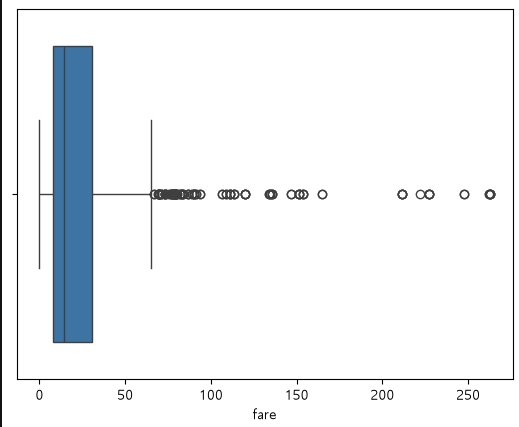
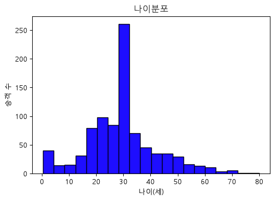

# 01 [ML] AI literacy

1. 기본 분류
- 인공지능 AI
- 머신러닝 ML
- 딥러닝 DL
  - 신경망 계산 : 입력값에 가중치를 곱하고, 편향을 더한 뒤, 활성화 함수를 통과시키는 과정
- 생성형 AI / LLM 
  - 생성형 AI : 새로운 결과물을 만드는 기술 전체
  - LLM은 **생성형 AI 중** 글(언어) 다루는 모델, 대화형 AI 서비스의 바탕 엔진
  - [참고] 모델(규칙) : '기계학습을 통해 만들어낸 규칙의 덩어리'로 이해

|전통 AI|ML|
|---|---|
|IF-THEN 규칙 직접 제공|데이터, 정답만 제공 -> 패턴 스스로 깨우치기|

2. 기타 새로 알게된 점
- 트랜스포머 : 문장 전체 한눈에 봄, self-attention, 단어 사이 관계의 가중치 계산, 병렬 연산 -> 앞부분 맥락잊는 문제 해결
- 컨텍스트 윈도우도 토큰으로 계산


# 02 [ML] 데이터 분석/처리(정제), 시각화

## 1️⃣ 관련 개념

### 1. 탐색적 데이터 분석(Exploratory Data Analysis, EDA)
- EDA : 데이터 분석 전에 데이터를 요약, 시각화하여 특징 파악(ex 결측치, 이상치 개수 확인)
```py
# 나이 결측값이 몇 개인지 확인
df["age"].isna().sum() 

# 박스 플롯으로 fare 살펴보기(이상치 확인)
sns.boxplot(data=df, x="fare")
```

### 2. 데이터 정제/처리/가공
- 데이터 정제 : 분석에 적합하도록 데이터를 수정하거나 삭제 처리(ex 결측치, 이상치 처리) 
```py
# 문자열로 인식된 데이터를 숫자로 치환
.str.replace() # 기호 삭제($, 콤마 등)
pd.to_numeric() # 숫자 변환

# 나이 결측값을 평균으로 채우기
df["age"].fillna(평균값)

# fare가 특정 기준을 넘는 행 제외하기
df = df[df["fare"] < 512].copy() # 제외되지 않은 행들만 복사해서 활용
```

### 3. 결측치 : 비어있는 값(null, NaN)

### 4. 이상치 : 일반적이지 않은 값

- 다른 데이터들과 비교했을 때 유난히 멀리 떨어져 있는 값, 박스 플롯으로 시각화하여 확인

- 박스 플롯 : 숫자 데이터가 어떻게 퍼져 있는지 상자와 선으로 요약해서 보여주는 그래프

| 박스 플롯의 요소 | 의미 |
|---|---|
| **상자 왼쪽 끝** | 25% 지점의 값: **1사분위수(Q1)** |
| **상자 안 세로선** | 50% 지점의 값: **중앙값(Q2)** |
| **상자 오른쪽 끝** | 75% 지점의 값: **3사분위수(Q3)** |
| **상자 가로 길이** | 데이터의 가운데 50%가 차지하는 범위의 크기 : **IQR**=Q3-Q1  |
| **상자 옆으로 뻗은 선** | 일반적인 값들의 분포를 표시하는 **수염**|
| **수염 밖의 점** | **이상치 후보**, 수염 경계(Q3 + 1.5 * IQR / Q1 - 1.5 * IQR) 넘는 값들 |

```PY
import seaborn as sns
import matplotlib.pyplot as plt

sns.boxplot(data=df, x="fare")
plt.show()
```


### 5. 유형별 데이터 처리 방법
(1) 숫자형 데이터(ex 나이) 결측치 : 전체 평균값이나 중앙값 활용 
(2) 문자/범주형 데이터(ex 탑승 항구) 결측치 : 최빈값(mode) 활용
(3) 이상치(outlier) : Boxplot으로 시각화하고 걸러내기

## 2️⃣ 실제 적용 (타이타닉 데이터 분석 및 가공)

### 1. 기초 작업, 데이터 로드 및 탐색

- 데이터 분석 및 시각화 패키지 설치(uv add)
```sh
uv add numpy pandas matplotlib seaborn ipykernel
```
| 패키지 | 역할 | 예시 |
|---|---|---|
| **NumPy** | 숫자 배열과 수치 계산 | 배열 만들기, 평균·합계 계산 |
| **Pandas** | 표 형태의 데이터 처리·분석 | CSV 읽기, 결측값 채우기, 조건에 맞는 행 선택 |
| **Matplotlib** | 그래프 그리기 | 꺾은선 그래프, 막대그래프 만들기 |
| **Seaborn** | 통계 그래프를 편하게 그리기 | 데이터 분포, 항목별 비교 그래프 만들기 |
| **ipykernel** | 파이썬 코드를 주피터 노트북에서 실행할 수 있게 연결 | VS Code에서 `.ipynb` 파일의 셀 실행 |

- .ipynb 파일 생성, kernel 선택, 패키지 import, 버전 확인
```py
import pandas as pd
import numpy as np
import seaborn as sns

print("pandas:", pd.__version__, "numpy:",  
np.__version__, "seaborn:", sns.__version__)
# pandas: 3.1.1 numpy: 2.5.5 seaborn: 0.13.2
```
- Seaborn 데이터 로드하기 : sns.load_dataset('이름')
  - Seaborn에서 제공하는 예제 데이터(타이타닉) 활용
```py
df = sns.load_dataset('titanic')
df.head(5)

# 결과
  survived	pclass	sex	    age	    sibsp  (...)
 0	0	    3	    male	22.0	1	
 1	1	    1	    female	38.0	1	
 2	1	    3	    female	26.0	0	
 3	1	    1	    female	35.0	1	
 4	0	    3	    male	35.0	0	
```

- 데이터 정보 확인 (.shape / .info() / .describe())
  - .shape(속성이므로 뒤에 ()쓰지 않음) : 데이터 행 개수, 열 개수
  - .info() : 데이터 구성과 각 열 상태(열 이름, 자료형, 결측이 아닌 값 개수 등) => **결측치** 확인
  - .describe() : 데이터 값 통계 요약(값의 분포) 확인(평균, 최솟값, 최댓값 등) => **이상치** 확인
```py
df.shape # (891, 15)

# 결측치 확인
df.info()

# 결과 : 전체 데이터 개수 891개이나, 일부 열의 개수가 그보다 작아 결측치 있다고 보임
<class 'pandas.DataFrame'>
RangeIndex: 891 entries, 0 to 890
Data columns (total 15 columns):
 #   Column       Non-Null Count  Dtype   
---  ------       --------------  -----   
 0   survived     891 non-null    int64   
 1   pclass       891 non-null    int64   
 2   sex          891 non-null    str     
 3   age          714 non-null    float64 
 (...)
dtypes: bool(2), category(2), float64(2), int64(4), str(5)
memory usage: 80.7 KB

-----------------------------------------------------------------------------

# 이상치 확인
df.describe()

# 결과 : fare의 평균, 상위 25% 값, 최댓값 확인 -> 이상치 있다고 예상된
	survived	pclass	age	    sibsp	parch	fare
count	891	    891 	714	    891	    891 	891
mean	0.3	    2.3	    29.6	0.5	    0.3	    32.2
std	    0.4 	0.8	    14.5	1.1	    0.8 	49.6
min 	0	    1	    0.4 	0	    0	    0
25%	    0   	2	    20.1	0	    0	    7.9
50%	    0   	3	    28	    0	    0	    14.4
75%	    1   	3	    38  	1	    0	    31
max	    1   	3	    80  	8	    6	    512.3
```

- 각 열의 null(NaN)값 총 개수 확인 : df.isnull().sum()
  - .isnull() : null값 여부가 True인 행 뽑기 / .sum()으로 반환값 True인 행 총 개수 합산
```py
df.isnull().sum()

# 결과 : age, embarked, deck, embark_town열 결측값 개수 확인
age            177
embarked         2
deck           688
embark_town      2
```

[참고] isnull / isna / notnull / notna
- .isnull() = .isna() : 결측값이면 T, 값이 있으면 F 반환
- .notnull() = .notna() : 값이 있으면 T, 결측값이면 F 반환


### 2-1. 결측치 처리 ① : 숫자(나이) 결측치 평균으로 채우기

- 나이 열의 값이 비어있는 행 찾기 : .isnull()
```py
# age열 값이 null/NaN인 행들
empty_age = df["age"].isnull() # 행 추출 조건
 
# 결과 : 모든 행들에 대해 age열 값이 결측값인지 확인, T,F 반환
0      False
1      False
2      False
3      False
4      False
       ...  

# 결측치 행들의 총 개수
empty_age.sum() # 총 나이 결측값 행 177개

# 결측치 행들 상위 5개
df.loc[empty_age, ["sex","age","class"]].head() # 상위 5개 추출
# .loc└─ 행(조건)  └─ 가져올 열 목록 ─┘

# [참고] loc 없이 사용
# df[empty_age][["sex", "age", "class"]].head()

# 결과
sex	age	class
5	male	NaN	Third
17	male	NaN	Second
19	female	NaN	Third
26	male	NaN	Third
28	female	NaN	Third
```

- 비어있는 값을 평균 혹은 중앙값으로 채우기 : .fillna()는 **NaN만** 주어진 값으로 채움!
```py
# 평균값, 중앙값 산출 (택1)
print("평균:", round(df["age"].mean(),2)) # 평균: 29.7
print("중앙값:", round(df["age"].median(),2)) # 중앙값: 28.0

# 평균 나이 값 저장
mean_age = df["age"].mean()

# 값 채우기 : 전체 행(:)의 age 열에 대해 빈값은 mean_age(평균값)으로 채우기
df.loc[:,"age"] = df["age"].fillna(mean_age)

# 채운 이후 최종적으로 빈칸이 있는지 확인
print(df["age"].isnull().sum()) # 0으로 나와야 정상

# 데이터 출력해서 채워진 것 확인
df.loc[empty_age, ["sex","age","class"]].head()

# 결과 : 비어있던 age 값들이 29.~ 평균치로 채워짐
    sex	        age	    class
5	male	29.699118	Third 
17	male	29.699118	Second
19	female	29.699118	Third
26	male	29.699118	Third
28	female	29.699118	Third
```

### 2-2. 결측치 처리 ② : 문자/범주형 데이터(탑승 항구) 결측치 최빈값으로 채우기

- 탑승항구 값 목록과 개수 확인 : .value_counts(dropna=False)
```py
df["embark_town"].value_counts(dropna=False)
# .value_counts() : 해당 열에 어떤 값이 있는지, 각각 몇 번 나오는지 카운트
# dropna=False 옵션 : 값 목록에 NaN도 포함, 결측값 개수도 함께 세어 보여줌

# 결과
embark_town
Southampton    644
Cherbourg      168
Queenstown      77
NaN              2 # dropna=False 덕분에 NaN 개수도 확인 가능
```

- 결측치에 최빈값 채우기 : .mode()[0]
  - 가장 많이 나온 값이 여러 개일 경우를 대비, [0]으로 첫번째 값 선택하여 고정

```py
# 최빈값 확인 후 저장
mode_town = df["embark_town"].mode()[0] # 탑승항구 최빈값 : Southampton

# 결측치를 최빈값으로 채우기
df.loc[:,["embark_town"]] = df["embark_town"].fillna(mode_town)

# 결측치 보완 결과 확인
df["embark_town"].value_counts(dropna=False)

# 결과
embark_town
Southampton    646 # 644에서 646으로 증가
Cherbourg      168
Queenstown      77
# NaN 2개 없어짐
```

- 탑승항구와 연계된 embarked 컬럼 값도 embark_town에 맞춰 수정
```py
# embarked town 값의 첫 글자를 embarked 값으로 수정
df.loc[:,"embarked"] = df["embark_town"].str[0] # 첫글자 str[0]

# embarked 열의 결측치 보완 결과 확인
df[["embarked","embark_town"]].isnull().sum() # 0 이어야 함

# 결과
embarked       0
embark_town    0
```

### 2-3. 결측치 처리 ② : 문자/범주형 데이터(deck 카테고리) 결측치 새 값으로 채우기

- deck 열 데이터 자료형 확인
```py
# 데이터 확인
df["deck"]
# 결과
0      NaN
1        C
2      NaN
3        C
4      NaN
      ... 

# 자료형 확인
print(df["deck"].dtype) # category
df["deck"].cat.categories # Index(['A', 'B', 'C', 'D', 'E', 'F', 'G'], dtype='str')
# .cat : 카테고리 관련 기능에 접근 / .categories : 카테고리 목록 가져옴
```

- 새로운 카테고리 추가 후 결측치 수정하기
```py
# unknown 카테고리 추가 및 결측치 채우기
df["deck"] = df["deck"].cat.add_categories("Unknown").fillna("Unknown")
# [참고] 카테고리 삭제는 remove_categories
```

- 결측치 보완결과 확인
```py
# 카테고리들 목록에 Unknown 추가됨
print(df["deck"].cat.categories.to_list())
# ['A', 'B', 'C', 'D', 'E', 'F', 'G', 'Unknown']

# 카테고리별 값들의 개수 목록
print(df["deck"].value_counts())

# 결과 
deck
Unknown    688
C           59
B           47
D           33
(...)

# 데이터 확인
df["deck"].head()

# 결과
0    Unknown
1          C
2    Unknown
3          C
4    Unknown

# 모든 열의 결측치 개수 확인
df.isnull().sum() # 0, 모든 열에 결측치 없음
```

### 3. 이상치 처리 : 너무 비싼 요금(fare) 걸러내기

- fare 열의 사분위수 확인하기 : .quantile([0.25, 0.5, 0.75])
```py
# 방법 1 : 요금 열 Q1, Q2, Q3값 출력
print(df["fare"].quantile([0.25, 0.5, 0.75]))

# 방법 2 : 통계 요약 결과에서 25%, 50%, 75%만 선택
df["fare"].describe()[["25%", "50%", "75%"]]

# 결과 (1,2 동일)
25%     7.9104
50%    14.4542
75%    31.0000
```

- IQR 계산 및 이상치 구하기
```py
# IQR 계산하기 : Q3 - Q1 
q1 = df["fare"].quantile(0.25)
q3 = df["fare"].quantile(0.75)
iqr = q3 - q1

# 이상치 구하기 : Q3 + 1.5 * IQR
upper = q3 + 1.5 * iqr # 경험적 수치

print(f"Q1={q1:.2f}, Q3={q3:.2f}, IQR={iqr:.2f}, UPPER={upper:.2f}")

# 결과
Q1=7.91, Q3=31.00, IQR=23.09, UPPER=65.63

# 이상치(upper)보다 큰 특이 값들 개수 확인 ⭐⭐⭐⭐⭐
(df["fare"]>upper).sum() # 116개

# ⭐ 문법 이해하기 ⭐
# 조건은 요금이 upper보다 큰 것들이다 : 조건 = df["fare"] > upper
# 해당 조건이 True인 행들 개수 합계 : 조건.sum()

# [참고] 두 가지 방법은 동일한 결과 나타냄
# len(df[df["fare"] > upper])  # 조건에 맞는 행을 고른 뒤 행 수 세기
# (df["fare"] > upper).sum()   # 조건 결과에서 True 개수 세기
# df["fare"] > upper 이렇게 조건식만 쓰면 T,F 결과 반환
# 조건식에 () 처리해서 조건식 먼저 완성한 다음, 그 결과에 .sum() 적용
# upper에 sum 적용되는 것 방지
```

- 명백히 동떨어진 값 가진 행들 제외 시 데이터 개수 확인
```py
# 전체 데이터 행 개수
before = len(df)

# 적정값(요금 512 미만) 행들만 담아 복사본 제작
df = df[ df["fare"] < 512 ].copy() 

# 이상치 제외 후 데이터 행 전후 비교
print(before, "=>", len(df)) # 결과 : 891 => 888
# 즉, 512 이상인 값들 삭제(-3행)하면 888행 남음
```

### 4. 중복 데이터 처리

- 중복 데이터 여부 확인 : .duplicated().sum(), 전체 값이 서로 중복되는 행들의 총 개수
```py
# 중복 행 개수 확인 
print("중복 행:", df.duplicated().sum())  # 107개

df[df.duplicated(keep=False)].sort_values(["fare", "age"]).head() # 가격, 나이 오름차순
# keep=False : 중복된 행 모두 True로 보여줌(중복행만 X, 원본행 중복행 둘 다 O)

# 결과 : 중복된 모든 행들 표시
    survived	pclass	sex	    age	        sibsp	parch	fare (...)			
277	0	        2	    male	29.699118	0   	0	    0.0			
413	0	        2	    male	29.699118	0	    0	    0.0			
466	0	        2	    male	29.699118	0   	0	    0.0			
481	0	        2	    male	29.699118	0   	0	    0.0			
674	0   	    2	    male	29.699118	0   	0	    0.0			
```

- 중복 데이터 삭제
```py
# 중복 행 제거 (첫 번째 데이터만 남기고 뒤에 나오는 중복 삭제)
df = df.drop_duplicates()

# [참고] 중복 제거하면서 인덱스 초기화/정렬
df = df.drop_duplicates().reset_index(drop=True)

# 제거 완료 후 중복 행 확인
df.duplicated().sum() # 0
```

### 5. 그래프로 시각화 하기

- 한글 폰트 설정 : Matplotlib으로 그래프 제목이나 축 이름에 한글을 쓰면, 기본 글꼴이   
  한글을 지원하지 않아 글자가 네모 □□□로 나오므로 Windows와 Mac에 맞춰 글꼴 지정 필요

```py
import platform 
import matplotlib.pyplot as plt

os_name = platform.system() # 운영체제 확인

os_name # 'Windows'

if os_name == "Windows":
    plt.rcParams['font.family'] = 'Malgun Gothic' # 윈도우
elif os_name == "Darwin":
    plt.rcParams['font.family'] = 'AppleGothic'   # 맥북
else:
    plt.rcParams['font.family'] = 'NanumGothic'   # 기타(코랩 등)

```

- 그래프 작성 준비 : plt.subplots()로 figure, axes 생성
  - Figure(fig,그래프가 들어가는 전체 그림판), Axes(ax,실제 그래프가 그려지는 영역) 준비
  - 도화지 하나에는 그래프 공간이 하나만 있을 수도 있고, 여러 개 있을 수도 있다!
```py
# figure, axes 영역을 만들어서 각각 fig, ax로 반환
fig, ax = plt.subplots(figsize = (6,4)) # 그림판 전체 크기는 가로 6, 세로 4인치
```

- 히스토그램 그리기 : .hist() / .set_title() / .set_xlabel() / .set_ylabel()
  - 히스토그램 : 숫자 데이터 여러 구간(bins)으로 나누고 구간별 데이터 개수를 막대로 표시
```py
# ax 영역에 히스토그램 그리기
ax.hist(df["age"], bins=20, color="blue", edgecolor="black")
# age열 데이터 표시, 20 구간, 막대 안쪽 파란색, 막대 테두리 검은색

# 히스토그램 제목 설정
ax.set_title("나이분포")

# x축 이름 설정
ax.set_xlabel("나이(세)")

# y축 이름 설정
ax.set_ylabel("승객 수")
```

