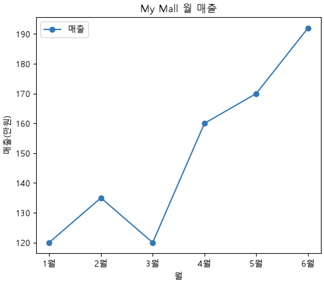
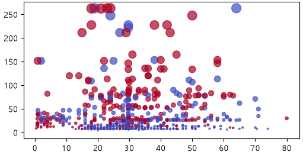
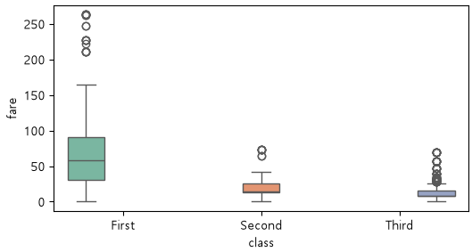
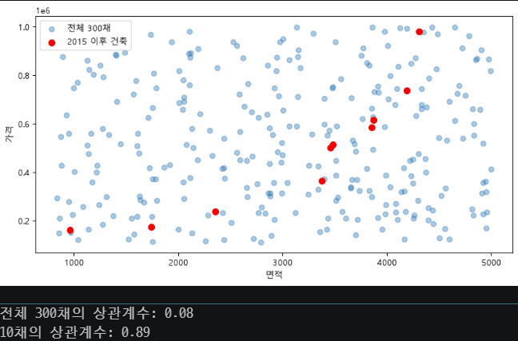
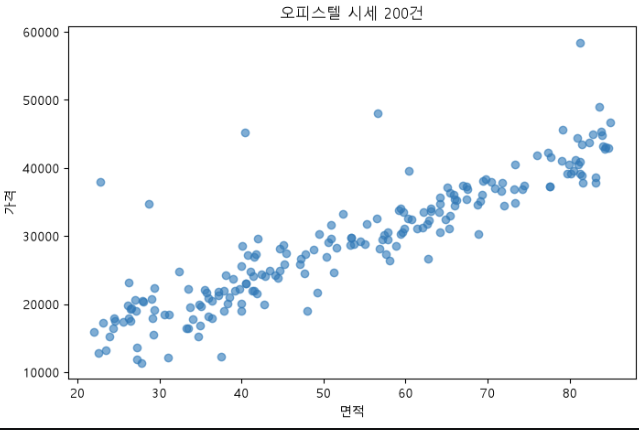
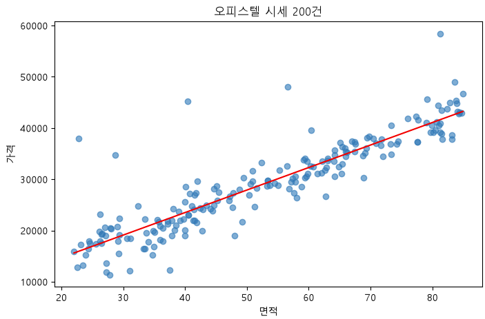

# 01 [ML] 데이터 시각화(2) 다양한 그래프 그리기

## 1️⃣ 그래프 그리기

### (1) 선 그래프 그리기 : ax.plot(x,y)
```py
import numpy as np
import pandas as pd
import seaborn as sns # 통계 그래프 작성 도와주는 라이브러리
import matplotlib.pyplot as plt

# 한글 폰트
plt.rcParams["font.family"]="Malgun Gothic"

# dataset 만들기(Figure(캔버스), Axes(그래프))
fig, ax = plt.subplots(figsize = (6,5))

# x축 데이터(월)
months = ["1월","2월","3월","4월","5월","6월"]

# y축 데이터(매출액, 만원)
sales = [120, 135, 120, 160, 170, 192]

# 선 그래프 
ax.plot(months, sales, marker="o", label="매출") #label : 범례명
ax.set_title("My Mall 월 매출") # 그래프 제목
ax.set_xlabel("월") # x축 제목
ax.set_ylabel("매출(만원)") # y축 제목
ax.legend() # 범례 표시
plt.show() # 차트 보기
```


### (2) 산점도 그리기
```py
fig, ax = plt.subplots(figsize=(6,3))

scatter = ax.scatter(
    df['age'],
    df['fare'],
    c=df['survived'], # 생존 여부(1: 생존, 0: 사망)에 따라 색상이 다름
    cmap='coolwarm',
    s=df['fare'] / 2, # 요금이 비쌀수록 원이 조금 더 큼, 너무 크지 않도록 /2
    alpha=0.7
)
```


[참고] 산점도 그래프 매개변수
| 매개변수 | 의미 | 역할 |
|---|---|---|
| `s` | Size | 점의 크기 (면적 기준) |
| `alpha` | Alpha | 점의 불투명도 (0~1, 0은 완전 투명, 1은 완전 불투명) |
| `c` | Color | 점의 색상 또는 색상을 결정하는 데이터값 |
| `cmap` | Colormap | 데이터값에 따라 적용할 색상표 (예: `coolwarm`, `viridis`) |

### (3) 박스플롯 그리기(Seaborn)

- 타이타닉 승객의 객실 등급별 운임(fare) 분포를 비교하는 박스플롯
  - 1~3등석 승객이 각각 얼마나 다양한 요금 지불했는지 비교 가능
```py
sns.boxplot(x="class",  y="fare",   # x축: 객실 등급, y축:운임
            data=df,                # data: 출처가 될 데이터프레임
            ax=ax,                  # ax: 그래프 그릴 영역 지정
            hue="class",            # hue: 객실마다 다른 색상 적용
            palette="Set2",         # palette: 색상표 특정 팔레트 적용
            legend=False)           # legend=False: 범례 미표시
```


> 박스플롯에서 박스가 높다는 것은 분포 범위가 넓다는 의미임!

❓ 왜 x,y축이 정해져있는데 df(데이터프레임 전체)를 data로 지정하는지❓
- 핵심은 data=df가 데이터프레임의 모든 열을 그래프에 표시하라는 뜻이 X
- data는 x, y에 사용할 데이터를 어디에서 가져올지(출처) 알려주는 역할을 함
- 즉, x="class", y="fare", data=df는 class, fare 열을 df에서 가져오겠다는 뜻
- 처음부터 x=df["class"], y=df["fare"]로 전달해주면 data 부분은 안써도 됨

### (4) 원형 그래프(Pie chart) 그리기 (생략)

# 02 [ML] 선형회귀

## 1️⃣ 선형관계 탐색

### 1. 기초 작업

- vscode 프로젝트에서 datasets 폴더 따로 생성 >  
  csv 파일을 해당 폴더로 드래그하여 업로드

- 데이터 로드하기
```py
# csv 파일 로드 및 저장 : 변수 = pd.read_csv("경로")
house = pd.read_csv("./datasets/usa_housing.csv")
```

- 데이터 확인하기
```py
house.head(5)

# 결과
Price	Bedrooms	Bathrooms	SquareFeet	YearBuilt	GarageSpaces	LotSize	ZipCode	CrimeRate	SchoolRating
0	221958	1	1.9	4827	1979	2	1.45	82240	48.60	5
1	771155	2	2.0	1035	1987	2	1.75	74315	92.03	9
2	231932	1	3.0	2769	1982	1	1.46	79249	52.08	3
3	465838	3	3.3	2708	1907	3	1.62	80587	61.65	1
4	359178	4	3.4	1175	1994	2	0.74	20756	15.66	4

print(house.shape) # (300, 10)
```

### 2. 전체 데이터, 필터링 데이터 상관관계 비교

- 데이터 필터링
```py
# 2015년 이후에 지어졌으며 범죄율이 40미만인 집들만 추출
small = house[(house["YearBuilt"]>2015) & (house["CrimeRate"]<40)]

small.shape # (10, 10)

small

# 결과(편집)
Price	YearBuilt CrimeRate
9	    2017	    37.60
33	    2021	    26.93
112	    2016	    20.98
```

- 산점도 그리기
```py
import matplotlib.pyplot as plt

plt.figure(figsize=(10,5))
plt.scatter(house["SquareFeet"], house["Price"], alpha=0.4, label="전체 300채")
plt.scatter(small["SquareFeet"], small["Price"], color="red", s=50, label="2015 이후 건축")

plt.xlabel("면적")
plt.ylabel("가격")
plt.legend()

plt.show()
```


- 상관계수 구하기 : .corr()
```py
# 전체 300채의 면적-가격 상관계수 
round(house["SquareFeet"].corr(house["Price"]),2) 
# 0.08 / 0으로 수렴, 거의 상관이 없음

# 10채의 상관계수
round(small["SquareFeet"].corr(small["Price"]),2)
# 0.89 / 1과 가까움. 어느정도 선형관계 있음
```

## 2️⃣ 선형회귀 학습

### 1. 연습용 데이터 생성 및 시각화

#### (1) office 데이터 생성 및 저장

- 가상의 오피스텔 200개에 대한 면적과 가격 데이터 만들기
  - 무작위로 면적-가격을 정하지 X 면적에 따라 가격이 비례하도록 설정
```text
① 오피스텔 200개의 면적 생성 : 20 ~ 85 사이에서 무작위 200개 값 생성
② 면적에 따른 가격 계산식 만들기 : 면적 * 450 + 5000 +-a(노이즈)
③ 특이 매물(이상치) 5개 생성
④ DataFrame으로 정리하고 통계 확인
```

**① 오피스텔 200개 면적 생성**
```py
# 오피스텔 200개의 면적 생성, 난수 생성 기준값(시드) 40 고정
rng = np.random.default_rng(40)

# 데이터 행 개수(200개) 저장
n = 200

# 20 이상 85 미만의 난수 n개 추출, area(면적)으로 저장
area = rng.uniform(20, 85, n) 
# uniform(시작값, 끝값, 추출 개수) : 시작값 이상 끝값 미만 
# 범위에서 균일한 가능성으로 데이터 n개 추출
```

**② 면적에 따른 가격 계산식 만들기**
```py
# y = 450x + 5000 + 노이즈
price = (450 * area + 5000 + rng.normal(0,2500,n)).round(-1)
# normal(평균, 표준편차, n) : 평균, 표준편차의 정규분포에서
# 난수 n개 발생, uniform과 달리 평균 근처 숫자가 더 자주 발생
# 평균이 0이면 양수, 음수 모두 나옴, 표준편차는 기본가격에서 얼마나 크게 흔들리는지 결정
```

**③ 특이 매물(이상치) 5개 생성**
```py
# 이상치가 될 행들의 인덱스 추출
special = rng.choice(n, 5, replace=False) # 같은 번호 중복X
# choice(N,n) : 0포함 N 미만의 수 중 무작위로 n개를 선택
# special = [53, 13,  2, 92, 71] <- 이 번호 행들이 이상치 됨

# 이상치 행들에 15000~25000미만 중 5개 수 뽑아 각각 더하기
price[special] += rng.uniform(15000, 25000, 5).round(-1)
# 배열연산, 동일한 위치의 값들을 한번에 더해줌!(for문 불필요)
```

**④ DataFrame으로 정리하고 통계 확인**
```py
# area(면적), price(가격) 열이 있는 office 표로 생성
office = pd.DataFrame({"area":area, "price":price})

# 통계 확인
office.describe().round(1) # 통계 결과값에 소수점 1자리 적용
# 결과
	area	price
count	200.0	200.0
mean	52.8	29138.4
std	18.6	9112.1
min	22.0	11400.0
25%	37.4	21615.0
50%	52.0	28965.0
75%	67.4	36377.5
max	84.9	58460.0
```

- 생성한 office 데이터를 csv 파일로 저장하기 
```py
office.to_csv("./datasets/office.csv", index=False)
# index 컬럼이 별도로 생기지 않도록 False 처리
```

#### (2) office 데이터 시각화, 상관계수 확인

- office 데이터 산점도 차트 출력, 상관계수 확인
```py
# 캔버스(figure) 생성
plt.figure(figsize=(8, 5))

plt.scatter(office["area"], office["price"], alpha=0.6)
plt.title("오피스텔 시세 200건")
plt.xlabel("면적")
plt.ylabel("가격")
plt.show()

print("상관계수:", office["area"].corr(office["price"]))
# 0.8963336215680755
```


### 2. 모델 학습

#### (1) Scikit-learn 라이브러리 준비

- scikit-learn : 파이썬에서 ML 쉽게 구현할 수 있도록 만들어진 라이브러리, 머신러닝 도구 모음

📍 라이브러리 역할 복습!
|라이브러리|주요 역할|
|---|---|
|NumPy	|숫자 배열 생성 및 수치 계산|
|Pandas	|데이터프레임으로 데이터 정리·분석|
|Matplotlib	|그래프 그리기|
|Seaborn	|통계 그래프 쉽게 그리기|
|Scikit-learn	|데이터를 학습하고 예측하는 머신러닝 모델 구현|

- Scikit-learn 설치 및 import
```py
uv add scikit-learn 
from sklearn.linear_model import LinearRegression
```

- Scikit-learn의 대표적인 사용법
```PY
# import
from sklearn.linear_model import LinearRegression

# ① 선형 회귀 모델 생성 : LinearRegression
model = LinearRegression()

# ② 모델 학습 : fit
model.fit(X, y)

# ③ 학습한 모델로 가격 예측 : predcit
y_pred = model.predict(X)

# ④ 학습한 기울기와 절편 확인 : coef, intercept
print(model.coef_)
print(model.intercept_)
```
---

#### (2) 모델 학습 : fit

- 특성(Feature, 면적)과 정답(Label, 집값) 나누고 X,y로 저장
  - 특성 : 모델이 예측에 사용하는 변수 (여기서는 면적)
    => 변수 X(특성값 모아 놓은 입력 데이터)에 저장
  - 정답(Label/Target) : 모델이 예측하려는 변수 (여기서는 가격)
    => 변수 y(실제 정답값들을 모아 놓은 데이터)에 저장
  - 🚨 Scikit-learn은 일반적으로 입력 데이터(X)를 2차원 형태  
    (샘플 수, 특성 수)로 받으므로, 특성이 하나일 때도 이중  
    대괄호를 사용하여 DataFrame 형태로 추출 (ex) df[["컬럼명"]]
```py
from sklearn.linear_model import LinearRegression
X = office[["area"]] # 입력 데이터(X) : 면적, 2차원 DataFrame
y = office["price"] # 정답 데이터(y): 가격, 1차원 Series
```

- 선형 회귀 모델 준비 및 학습
  - LinearRegression()로 모델 생성 후 .fit(X,y)로 모델 학습
  - 모델이 추정(학습)한 .coef_(기울기), .intercept_(절편) 확인
```py
# 선형 회귀 모델 생성
model = LinearRegression()

# 학습 : X,y를 보고 오차 최소화하는 w(기울기), b(절편) 계산
model.fit(X,y)

# 학습 결과: 모델이 추정한 기울기와 절편 확인
print(f"기울기 w = {model.coef_[0]} / 원래 설정값 : 450")
# 기울기 w = 439.45870417134705 / 원래 설정값 : 450
print(f"절편 b = {model.intercept_} / 원래 설정값 : 5000")
# 절편 b = 5926.680580056112 / 원래 설정값 : 5000
```

#### (3) 학습 완료 후 기존/새 데이터 예측 : model.predcit(df)

- 기존 데이터 활용, 이미 알고 있는 가격을 모델로 예측해보기
```py
y_pred = model.predict(X) # X : 기존 입력 데이터
y_pred
# 결과
[35565.27071235 34523.12515748 41621.65499175 16419.80476903
 34440.45897837 41063.96986185 28303.6569948 (...)]
```

- 새 데이터(33, 59㎡ 면적인 집들)의 가격 예측
```py
# 면적이 33, 59인 새 데이터프레임 생성
new = pd.DataFrame({"area":[33, 59]})

# 새 데이터(면적)들의 가격 예측하기
model.predict(new).round(-1) # array([20430., 31850.])

# y = 450x + 5000 식과 근사치인것 확인
450 * 33 + 5000 = 19850 # 20430
450 * 59 + 5000 = 31550 # 31850
```

#### (4) 모델이 찾은 직선 그래프 그리기
- 데이터 준비 : 그리기 전, X축 특성 기준으로 데이터 정렬 하기
  - plt.plot()은 점을 데이터에 든 순서대로 연결하므로, x축값  
    순서대로 오름차순 정렬하지 않으면 선 연결할 때 순서 꼬임
```py
# X의 200개 데이터를 면적 오름차순으로 정렬(원본 변함X)
line = X.sort_values("area")

# 정렬된 새 데이터 기준, 새 가격(y) 예측 만들어 저장
line_pred = model.predict(line)
```

- 비교를 위해, 기존 데이터들의 산점도 차트 그리기
```PY
# 캔버스(figure) 생성
plt.figure(figsize=(8, 5))

# 산점도 그리기
plt.scatter(office["area"], office["price"], # X축 데이터, Y축 데이터
            alpha=0.6, label="실제 시세")
```

- 모델 예측 직선 그래프 그리기 : plt.plot(x축 데이터, y축 데이터)
```PY
# 면적(x축)과 모델 예측 가격(y축) 연결하여 직선 그리기
plt.plot(line["area"], line_pred, color="red", label="모델의 직선")
plt.title("오피스텔 시세 200건") # 차트 제목
plt.xlabel("면적") # 차트 X축 이름
plt.ylabel("가격") # 차트 Y축 이륵
plt.show() # 차트 그리기

# 상관계수(면적과 가격의 상관관계) 확인
office["area"].corr(office["price"])
```


#### (5) 정확도 확인

- 선형 회귀 모델의 오차(정확도) 평가 지표 4가지
| 구분 | MAE | MSE | RMSE | R² (R-score) |
|---|---|---|---|---|
| 정식 명칭 | 평균 절대 오차 | 평균 제곱 오차 | 평균 제곱근 오차 | 결정계수 |
| 계산 방식 | 오차 절댓값의 평균 | 오차 제곱의 평균 | MSE에 제곱근 적용 | 평균값 예측 대비 설명력 평가 |
| 특징 | 평균 오차를 직관적으로 파악 | 큰 오차에 매우 민감 | 큰 오차에 민감하며 해석이 쉬움 | 모델의 전반적인 설명력 확인 |
| 값의 범위 | 0 이상 | 0 이상 | 0 이상 | 1 이하 (음수 가능) |
| 좋은 값 | 0에 가까울수록 | 0에 가까울수록 | 0에 가까울수록 | 1에 가까울수록 |
| 단위 | 원래 데이터 단위 | 원래 단위의 제곱 | 원래 데이터 단위 | 단위 없음 |
| Scikit-learn 함수 | `mean_absolute_error()` | `mean_squared_error()` | `root_mean_squared_error()` | `r2_score()` |

- **MAE** : 평균적으로 얼마나 틀렸는가?
- **MSE** : 큰 오차에 더 큰 불이익을 주면 오차가 얼마나 되는가?
- **RMSE** : 큰 오차를 중요하게 반영하면서 원래 단위로 나타내면 오차가 얼마나 되는가?
- **R²** : 모델이 정답값의 변동을 얼마나 잘 설명하는가?
---

- MAE, MSE, RMSE, R2Score 값들 통해 실제-예측 오차 확인
```py
from sklearn.metrics import mean_absolute_error,  
mean_squared_error, root_mean_squared_error, r2_score

# MAE : 오차 절댓값의 평균
print(f"MAE={mean_absolute_error(y, y_pred):,.0f}") # 2,493
# 실제 가격-예측가격 평균적으로 2,493만큼 차이 남

# MSE : 오차 제곱의 평균 (단위 제곱)
print(f"MSE={mean_squared_error(y, y_pred):,.0f}") # 16,240,971

# RMSE : 오차 제곱 평균의 제곱근(루트) (원래 단위) 
print(f"RMSE={root_mean_squared_error(y, y_pred):,.0f}") # 4,030
# 이상치 때문에 RMSE > MAE일 가능성 다분

# R2SCORE : 결정 계수, 모델 정확성
print(f"R_SCORE = {r2_score(y, y_pred):.3f}") # 0.803
# 모델이 실제 가격 변동의 약 80%를 설명
```

#### (6) 이상치 제거 전후 정확도 비교

- 불리언 마스킹을 통해 이상치 제외한 정상 데이터만 저장
  - 불리언 마스킹 : True인 위치(행 인덱스)의 데이터만 선택, False 위치는 제외 
```text
① np.ones(n, dtype=bool) n개만큼 1이 든 NumPy 배열 생성,   
   배열 자료형을 불리언으로 지정하여 True로 전체 초기화
② df[이상치 데이터 인덱스값들] = False : 이상치만 False 변경
③ 
```

```py
# 전체 데이터 개수 확인 
all_rows = np.ones(len(office), dtype=bool) # 200

# office 데이터 행만큼 1이 든 NumPy 배열 생성, True로 초기화
normal = np.ones(len(office), dtype=bool)

# 특이매물 인덱스([53 13  2 92 71]) 값들을 False 처리 
normal[special] = False

# 1(=True) 값 합계, 즉, True 행 개수 = 정상치 개수 확인
normal.sum() # 195
```

- 이상치 포함 여부에 따른 모델 예측 비교
```PY
# 비교 그룹 리스트로 묶고 for문으로 동일한 평가작업 반복
cases = [("전체 200건", all_rows),("특이매물 제외 195건", normal)]

# for문 튜플 언팩킹하여 각 데이터셋의 실제/예측 가격 산출
for name, mask in cases:
    # name : "전체 200건", "특이매물~" 문자열
    # mask : all_rows, normal 데이터
    y_true = y[mask]      # y = office["price"] / 실제 가격
    y_hat = y_pred[mask]  # y_pred = model.predict(X) / 예측 가격
    # y/y_pred 가격들 중에서 mask가 True인 위치 값만 꺼내 저장

    # MAE
    mae = mean_absolute_error(y_true, y_hat)

    # RMSE
    rmse = root_mean_squared_error(y_true, y_hat)

    # R2Score
    r2 = r2_score(y_true, y_hat)

    print(f"{name} MAE {mae} | RMSE {rmse} | R2score {r2}")

# 결과(소수점 편집)
전체          200건 MAE 2492 | RMSE 4030 | R2score 0.8
특이매물 제외 195건 MAE 2075 | RMSE 2731 | R2score 0.9
```