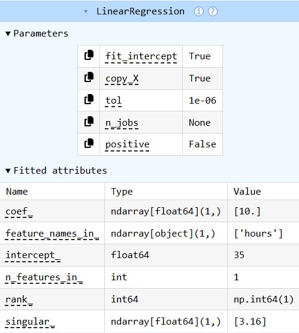
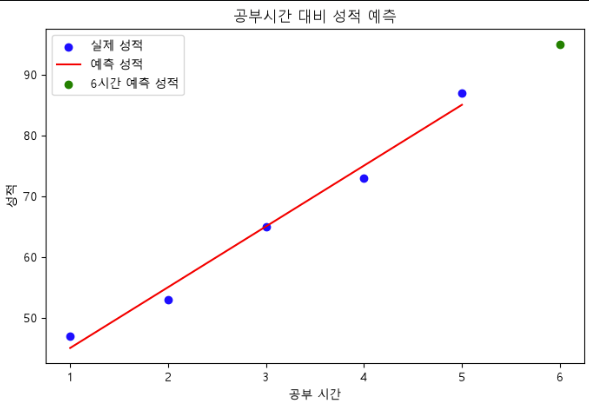
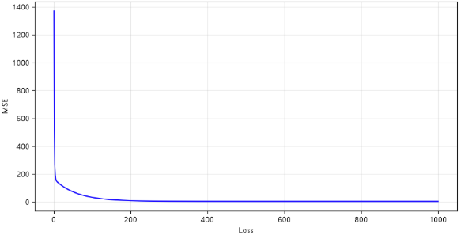
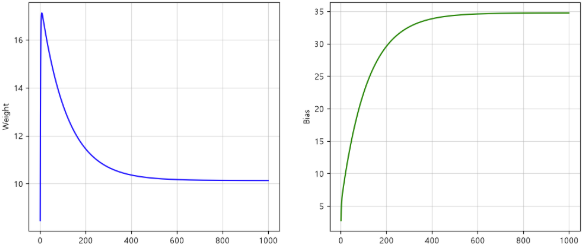
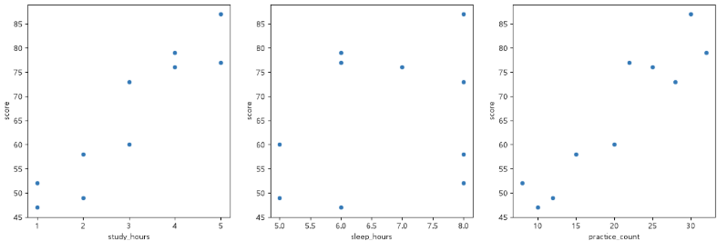
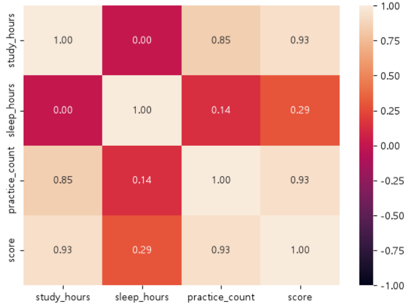

# 01 [ML] 선형회귀 복습

## 1️⃣ 학습데이터 준비
```py
import pandas as pd
import matplotlib.pyplot as plt

# 선형회귀 모델 임포트
from sklearn.linear_model import LinearRegression

plt.rcParams["font.family"] = "Malgun Gothic"
plt.rcParams['axes.unicode_minus'] = False
# 그래프 -(마이너스) 깨지지 않도록 방지
 
# 공부시간 및 성적 데이터
data = {
    "hours":[1, 2, 3, 4, 5],
    "scores":[47, 53, 65, 73, 87]
}

# 판다스 데이터프레임 전환
df = pd.DataFrame(data)

# 결과
    hours	scores
0	1   	47
1	2	    53
2	3	    65
3	4	    73
4	5	    87
```

## 2️⃣ 입력 데이터와 정답 데이터 분리
```py
# 입력데이터(Feature) : 2차원 - 독립변수
X = df[["hours"]]

# 출력/정답 데이터(Target) : 1차원(결과값 하나) - 종속변수
y = df["scores"]
```

## 3️⃣ 모델 생성 및 학습
```py
# 선형회귀 모델 객체 생성
model = LinearRegression()

# 모델 학습
model.fit(X,y)
```


## 4️⃣ 모델 예측(기울기, 절편) 확인
```py
print(f"기울기: {model.coef_[0]:.2f}") # weight
# 다중 선형회귀의 경우 결과값이 배열로 return, 여러 값 가능 -> 인덱싱[0]

print(f"절편: {model.intercept_:.2f}") # bias, 항상 단일 값

# 결과
기울기: 10.00
절편: 35.00

# 모델 예측 : y = 10 * x + 35
```

## 5️⃣ 새 데이터 예측 결과
```PY
# 6시간 학습한 학생의 성적 예측

# X 독립변수 값
new_data = pd.DataFrame({"hours":[6]}) # 그냥 6만 쓰면 2차원이 안만들어짐

# y 종속변수 값
predicted_score = model.predict(new_data)

print(f"6시간 학습한 학생의 예상 성적: {predicted_score[0]:.2f}") # 95.00
# 소수점 서식 없으면 [95. ]와 같이 배열 그대로 출력 가능
# 소수점 서식 때문에 배열 아닌 숫자가 와야해서 [0]로 꺼냄
```
#### [참고] 배열로 출력되는 예측결과 인덱스 사용 여부

| 사용 목적 | `[0]` 필요 여부 |
| --- | --- |
| 배열 그대로 출력 | 불필요 |
| 배열을 그래프에 전달 | 불필요 |
| 첫 번째 예측값만 추출 | 필요 |
| `.2f`로 숫자 서식 지정 | 필요, 배열에서 숫자꺼냄 |

⭐ 핵심 : 값이 하나 들어있는 배열과 숫자 하나는 서로 다르다!

#### [참고] 배열 내 여러개 결과값 각각 추출시 (인덱싱)
```py
# 배열에서 인덱스로 각 값 1개씩 꺼내오기
print(f"6시간 학습한 학생의 예상 성적: {predicted_score[0]:.2f}점")
print(f"7시간 학습한 학생의 예상 성적: {predicted_score[1]:.2f}점")
print(f"8시간 학습한 학생의 예상 성적: {predicted_score[2]:.2f}점")
```

## 6️⃣ 학습결과 시각화
```py
# 학습 데이터에 대한 예측값
y_pred = model.predict(X)
print("학습 데이터 예측값:", y_pred) # [45. 55. 65. 75. 85.]

# 캔버스 생성
plt.figure(figsize=(8,5))

# 실제 성적 (산점도)
plt.scatter(X["hours"], y, color="blue", label="실제 성적")

# 예측 성적 (회귀직선)
plt.plot(X["hours"], y_pred, color="red", label="예측 성적")

# 6시간 학습한 학생의 예측 성적
plt.scatter(6, predicted_score[0], color="green", 
label="6시간 예측 성적")

plt.title("공부시간 대비 성적 예측")
plt.xlabel("공부 시간")
plt.ylabel("성적")
plt.legend() # label 보이기
plt.show()
```


## 7️⃣ 모델 평가
```py
from sklearn.metrics import mean_absolute_error # 오차 절댓값 평균
from sklearn.metrics import mean_squared_error # 오차 제곱 평균
from sklearn.metrics import root_mean_squared_error # 오차 제곱 루트 평균
from sklearn.metrics import r2_score # 결정계수, 모델 설명력

# MAE : 오차 절대 평균, 오차 크기를 직관적으로 이해
mae = mean_absolute_error(y, y_pred)
print(f"학습데이터 평균 절대 오차(MAE): {mae:.2f}") # 1.60

# MSE : 오차 제곱 평균, 큰 오차에 대해 민감하게 반응
# 제곱하므로 면적이 나옴. 이 면적이 작아야 오차값 작은 것
mse = mean_squared_error(y, y_pred)
print(f"평균 오차 제곱(MAE): {mse:.2f}") # 3.20 

# RMSE : 오차 제곱 평균의 루트, 같은 단위
rmse = root_mean_squared_error(y, y_pred)
print(f"평균 오차 제곱 루트(RMSE): {rmse:.2f}") # 1.79

# R2score : 결정계수
# 모델이 실제 데이터를 얼만큼 정확하게 따라가는지
# 0 ~ 1(1에 가까울수록 정확한 모델), 음수일 경우 학습 실패
r2 = r2_score(y, y_pred)
print(f"결정계수(R2score): {r2:.2f}") # 0.98
```

#### [참고] MAE, MSE, RMSE, R²에서 무엇을 봐야 하는가?

| 분석 순서 | 분석 내용 |
| --- | --- |
| MAE 확인 | 평균적으로 얼마나 틀리는지 확인 |
| RMSE 확인 | 큰 오차를 중요하게 고려한 전체 오차 수준 확인 |
| MAE와 RMSE 비교 | 오차 크기의 균일성 및 큰 오차의 존재 가능성 파악 |
| 잔차 분포 확인 | 실제로 어떤 데이터에서 크게 틀렸는지 확인 |
| R² 확인 | 모델의 전체적인 설명력 확인 |

#### [참고] MAE, RMSE의 관계성 

| MAE와 RMSE의 관계 | 해석 |
| --- | --- |
| MAE = RMSE | 모든 오차의 절댓값이 동일함 |
| MAE ≈ RMSE | 오차의 크기가 비교적 균일함 |
| MAE ≪ RMSE | 일부 큰 오차가 존재할 가능성이 있음 |

- 예측 오차가 발생 원인 ? (무조건 이상치 때문은 X)
  - 원본 데이터에 이상치가 존재함
  - 모델이 특정 데이터 특성을 제대로 설명하지 못함
  - 예측에 필요한 독립변수가 누락됨
  - 실제 데이터가 비선형인데 선형회귀 모델을 사용

<br>

---

# 02 [ML] 경사하강법

## 🔽 관련 개념

### 1. 머신러닝 전체 학습 과정
```text
① 모델의 초기 가중치(w), 편향(b) 설정 : 아직 학습하지 않은 모델
② 예측값 계산 : \(\hat{y}=wx+b\)
③ 오차 계산 : \(e=y-\hat{y}\)실제값과 예측값의 차이
④ 손실함수 및 비용함수 계산 : 모델이 얼마나 잘못 예측했는지 수치화
⑤ 손실함수 또는 비용함수 미분 : 어느 방향으로 가중치를 변경할지 판단
⑥ 경사하강법으로 w, b 업데이트 : 손실을 줄이는 방향으로 모델 수정
②~⑥ 과정 반복
⑦ 학습 완료 : 손실을 충분히 줄인 가중치와 편향 확보
```

### 2. 오차, 손실, 비용

#### (1) 오차와 손실
- 오차 : 예측값 - 실제값, 얼마나 빗나갔는지 알려주는 값

- 손실 : 오차를 바탕으로 모델이 얼마나 잘못 예측했는지(틀린 정도) 알려주는 값
  - 오차에 절댓값을 한 절대오차 손실, 제곱을 한 제곱오차 손실 등 활용

#### (2) 손실함수(Loss Function)
- 손실함수 : 각 데이터 손실값 계산식. 절대오차 손실함수, 제곱오차 손실함수 등

- 절대오차 손실함수
$$
L = |\hat{y} - y|
$$

- 제곱오차 손실함수
$$
L_i=(y_i-\hat{y}_i)^2
$$

#### (3) 비용함수(Cost Function)
- 비용함수 : 여러 데이터 손실을 모아서 모델 전체의 성능을 평가. MAE, MSE 등
  - cf. 손실함수는 보통 데이터 한 개의 예측이 얼마나 틀렸는지 계산

- MAE
$$
J(w,b)=\frac{1}{n}\sum_{i=1}^{n}|\hat{y}_i-y_i|
$$

- MSE
$$
J(w,b)=\frac{1}{n}\sum_{i=1}^{n}
(\hat{y}_i-y_i)^2
$$

### 3. 경사하강법(Gradient Descent) 

#### (1) 경사하강법 개념

- 경사하강법 : 비용함수가 작아지도록 예측직선 가중치(w)와 편향(b)을 학습률 따라 조금씩 조정

  - ML에서 기울기='가중치'? : 입력값 x에 곱해져서, 입력값이 예측값에 얼마나 영향을 미치는지 조절하므로

  - ML에서 절편='편향'? : 입력값에 가중치 곱한 결과에 더해져, 예측값을 전체적으로 한쪽으로 이동시키므로

  - 학습률 : 비용함수 기울기를 이용해서 예측 직선 가중치(w)를 얼마나 바꿀지 결정
    

#### (2) 경사하강법 움직임 공식

- 가중치 업데이트 공식

$$
w_{new}=w_{old}-\alpha\cdot\frac{\partial J}{\partial w}
$$

-
  - $w_{new}$**(새 위치)**: 다음번에 발을 디딜 새로운 좌표(업데이트된 가중치)

  - $w_{old}$ **(현 위치)**: 지금 서 있는 현재 좌표(현재의 가중치)
  
  - $\alpha$ **(학습률, Learning Rate)**: 한 번에 얼마나 크게 걸음을 내디딜지 결정하는 '보폭'
  
  - $\frac{\partial J}{\partial w}$**(기울기, Gradient)**: 현재 위치에서 느껴지는 '땅의 가파른 정도(경사)'

- 편향 업데이트 공식

$$
b_{\text{new}}=b_{\text{old}}-\alpha
\frac{\partial J}{\partial b}
$$

#### (3) 경사하강법 종류 

- 배치 경사하강법 (BGD) : 전체 데이터 사용하여 비용함수 기울기 계산, 가중치 1회 변경
  - 장점 : 전체 데이터를 보고 조정하므로 업데이트 방향이 비교적 안정적
  - 단점 : 데이터가 많으면 가중치를 한번 바꾸는데 시간과 리소스가 많이 들 수 있음

- 확률적 경사하강법 (SGD) : 데이터 한 행을 사용하여 비용함수 기울기 계산, 가중치 1회 변경
  - 장점 : 한 행만으로 계산하므로 한 번의 업데이트가 빠르고 자주 일어남 
  - 단점 : 한 행의 기울기가 전체 데이터의 기울기와 다를 수 있어 가중치 변동 클 수 있음


## 1️⃣ 학습데이터 준비
```py
import pandas as pd
import matplotlib.pyplot as plt
from sklearn.linear_model import LinearRegression

from sklearn.linear_model import SGDRegressor
from sklearn.metrics import mean_squared_error


# 학습 데이터 생성 : 공부시간과 성적
df = pd.DataFrame({
    "hours":[1, 2, 3, 4, 5],
    "scores":[47, 53, 65, 73, 87]
})

# 독립변수 (입력변수, Feature)
X = df[["hours"]]

# 종속변수 (정답, Target)
y = df["scores"]

df

# 결과

  hours	scores
0	1	47
1	2	53
2	3	65
3	4	73
4	5	87
```

## 2️⃣ 선형회귀 모델 학습 (이후 경사하강법과 비교)

```PY
# 선형회귀 모델 생성
model = LinearRegression()

# 모델 학습
model.fit(X,y)

# 예측값
y_pred = model.predict(X)

# 결과값(기울기, 절편, MSE) : 경사하강법으로 도달하려는 목표
print(f"Weight:{model.coef_[0]:.2f}") # 10.00
print(f"Bias:{model.intercept_:.2f}") # 35.00
print(f"MSE:{mean_squared_error(y, y_pred):.4f}") # 3.2000
```

## 3️⃣ 확률적 경사하강법(SGD) 모델

### 1. 경사하강법 모델 생성
```py
# 모델 객체 생성 및 하이퍼파라미터 설정
sgd = SGDRegressor(
    loss="squared_error",     # 제곱 오차 기반 손실함수 생성
    learning_rate="constant", # (초기) 학습률을 일정하게 유지
    eta0=0.01,                # 초기 학습률
    max_iter=1000,            # 학습 횟수(fit() 반복 횟수)
    shuffle=False,            # 학습 데이터 섞지 않음
    random_state=42           # 난수 시드 설정
) 
```
[참고] SGD 하이퍼파라미터 설정 (지정 안하는 경우 default 설정됨)

| 설정 | 정하는 내용 |
|---|---|
| `loss` | 어떤 방식으로 손실을 계산할지 |
| `learning_rate` | 학습률을 어떻게 바꿀지 (deafult:"invscaling"-학습률 점차 감소) |
| `eta0` | 시작 학습률을 얼마로 할지 |
| `max_iter` | `fit()`에서 최대 몇 에포크까지 학습할지 |
| `shuffle` | 학습 데이터를 매 에포크 섞을지 |
| `random_state` | 무작위 동작을 재현할 때 사용할 값 |

### 2. 경사하강법 모델 학습

#### (1) 학습 및 중간 결과 저장
```py
# 전체 데이터 기준 총 몇 번 학습할 것인지 선언
# 위의 max_iter=1000은 fit()에 적용, 지금은 partial_fit()쓰므로 밖에서 선언 필요
epochs = 1000

# 학습 과정 저장 리스트 생성
history = []

# 학습 반복
for epoch in range(epochs):
    # 전체 데이터 1회 학습 (1 epoch)
    sgd.partial_fit(X,y)  # 한번 학습 후 기존 학습결과 유지

    # 1회 학습 후 예측
    y_pred = sgd.predict(X)

    # 현재 모델의 MSE 계산
    mse = mean_squared_error(y, y_pred)

    # 현재 학습 결과 저장(딕셔너리로 누적)
    history.append({
        "epoch": epoch+1, # epoch는 0~999까지의 숫자
        "Weight": sgd.coef_[0],
        "Bias": sgd.intercept_[0],
        # SGDRegressor는 가중치, 편향 하나여도 배열로 저장
        "mse": mse
    })

# 학습 기록을 데이터프레임으로 변환
history_df = pd.DataFrame(history)

history_df.head()

# 결과
    epoch	Weight	    Bias	    mse
0	1	    8.455225	2.731163	1369.816039
1	2	    12.813586	4.270770	515.808449
2	3	    15.045308	5.190714	269.417813
3	4	    16.173242	5.787904	193.744630
4	5	    16.728403	6.216494	167.673523
# [참고] 학습을 많이 하면 epoch 막바지쯤 수렴되어 동일값 반복되기도 함
```
[참고] fit()과 partial_fit()

| 구분 | `fit()` | `partial_fit()` |
|---|---|---|
| 호출 한 번에 | 설정된 조건에 따라 여러 에포크 학습 | 전달한 데이터를 한 번 학습 |
| 반복 횟수 | `max_iter`가 최대 횟수를 정함 | 직접 호출한 횟수로 조절 |
| 다시 호출하면 | 기본적으로 처음부터 다시 학습 | 이전 학습에서 이어서 학습 |
| 활용 예 | 일반적인 모델 학습 | 데이터를 나눠 학습하거나 중간 결과를 확인할 때 |


#### (2) 학습 결과 확인
```py
history_df[
    history_df["epoch"].isin([1,5,10,50,100,300,500,1000])
]
# epoch 1,5,10,50,100,300,500,1000번 값만 출력 

# 결과
    epoch	Weight	    Bias	    mse
0	1	    8.455225	2.731163	1369.816039
4	5	    16.728403	6.216494	167.673523
9	10	    17.060518	7.615610	141.377004
49	50	    15.031795	15.629821	72.111791
99	100	    13.294764	22.401342	32.278720
299	300	    10.678818	32.599172	4.254356
499	500	    10.223895	34.372614	3.302220
999	1000	10.129335	34.741238	3.250159
```

### 3. 경사하강법 시각화

#### (1) 손실(비용)함수 차트

```py
plt.figure(figsize=(10,5))

# epoch에 따른 mse 변화
plt.plot(
    history_df["epoch"],
    history_df["mse"],
    color = "blue",
    label="학습 손실(Training Loss)",
)

plt.xlabel("Loss")
plt.ylabel("MSE")
plt.grid(alpha=0.3)
plt.show()
```


#### (2) 예측 직선 기울기, 절편 변화 시각화

```py
fig, axes = plt.subplots(1, 2, figsize=(12, 5)) # 한 시트에 차트 2개

# axes[0], axes[1] 2개가 만들어짐

# 기울기 변화
axes[0].plot(
    history_df["epoch"],
    history_df["Weight"],
    color="blue"
)

axes[0].grid(alpha=0.5)
axes[0].set_ylabel("Weight")

# 절편 변화
axes[1].plot(
    history_df["epoch"],
    history_df["Bias"],
    color="green"
)

axes[1].grid(alpha=0.5)
axes[1].set_ylabel("Bias")

plt.show()
```


### 4. 최종 모델로 새 데이터 예측, 모델간 비교

```py
# 최종 학습된 기울기, 절편
print(f"기울기: {sgd.coef_[0]:.2f}") # 기울기: 10.13
print(f"절편: {sgd.intercept_[0]:.2f}") # 절편: 34.74

# 6시간 학습한 학생
new_data = pd.DataFrame({"hours": [6]})

# 경사하강법으로 학습한 모델로 예측
prediction = sgd.predict(new_data)

print(f"예측 성적 : {prediction[0]:.2f}") # 예측 성적 : 95.52
```
||선형회귀모델|경사하강법 모델|
|---|---|---|
|기울기|10.00|10.13|
|절편|35.00|34.74|
|6H 성적 예측|95.00|95.52|

---

<br>

# 03 [ML] 다중선형회귀(Multiple Linear Regression)

## 🔽 관련 개념
- 다중 선형 회귀 : 여러 개의 원인(독립 변수)을 입체적으로 조합하여  
  하나의 결과(종속 변수)를 정밀하게 예측하는 알고리즘

## 1️⃣ 라이브러리 임포트 및 데이터 준비

```py
import pandas as pd
import matplotlib.pyplot as plt
import seaborn as sns

from sklearn.linear_model import LinearRegression

from sklearn.metrics import mean_absolute_error
from sklearn.metrics import mean_squared_error
from sklearn.metrics import r2_score


# 공부시간, 수면시간, 연습량(문제풀이 개수), 성적 데이터
df = pd.DataFrame({
    "study_hours":    [1, 2, 3, 4, 5, 2, 3, 5, 4, 1],
    "sleep_hours":    [6, 8, 5, 7, 8, 5, 8, 6, 6, 8],
    "practice_count": [10, 15, 20, 25, 30, 12, 28, 22, 32, 8],
    "score":          [47, 58, 60, 76, 87, 49, 73, 77, 79, 52]
})

df.head()

# 결과

    study_hours	sleep_hours	practice_count	score
0	1	        6	        10	            47
1	2	        8	        15	            58
2	3       	5	        20	            60
3	4	        7	        25	            76
4	5	        8	        30          	87
```

## 2️⃣ Feature별 상관관계 확인

### (1) 산점도 확인

```py
# 1행 3열의 그래프 영역 생성
fig, axes = plt.subplots(1,3,figsize=(16, 5))

# 공부시간-성적 산점도
sns.scatterplot(
    data = df,
    x="study_hours",
    y="score",
    ax=axes[0]
)

# 수면시간-성적 산점도
sns.scatterplot(
    data = df,
    x="sleep_hours",
    y="score",
    ax=axes[1]
)

# 문제풀이 개수-성적 산점도
sns.scatterplot(
    data = df,
    x="practice_count",
    y="score",
    ax=axes[2]
)

plt.show()
```


### (2) 상관계수(히트맵) 출력

- heatmap(): 숫자를 색깔로 바꿔서 보여주는 그래프를 그리는 함수
  - (ex) 여러 컬럼의 상관계수 값의 크기나 패턴을 색으로 한눈에 비교

```py
# 모든 컬럼 사이의 상관계수 확인
corr = df.corr()
# 참고 : 컬럼 하나에서 .corr 쓸때는 df["컬럼1"].corr(df["컬럼2"])

# 캔버스 생성
plt.figure(figsize=(7,5))

# 히트맵 그리기(seaborn)
sns.heatmap(
    corr,       # 히트맵으로 그릴 데이터 : 상관계수 표
    annot=True, # 각 칸에 상관계수 값 표시
    vmin=-1,    # 색상 기준의 최솟값
    vmax=1,     # 색상 기준의 최댓값
    fmt=".2f"
)
plt.show()
```


[참고] 히트맵 그리기 옵션

| 항목 | 역할 | 예시 |
|---|---|---|
| `data` | 히트맵으로 표시할 데이터 | `corr` |
| `annot` | 각 칸에 숫자 표시 여부 | `True`: 표시, `False`: 표시 안 함 |
| `cmap` | 값에 따라 사용할 색상표 | `"coolwarm"` |
| `vmin` | 색상 기준의 최솟값 | `-1` |
| `vmax` | 색상 기준의 최댓값 | `1` |
| `fmt` | 칸에 표시하는 숫자의 형식 | `".2f"`: 소수점 둘째 자리까지 |