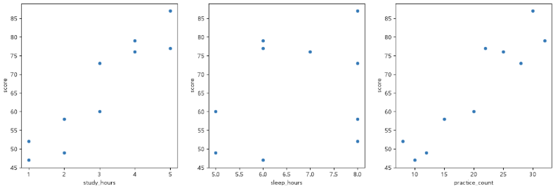
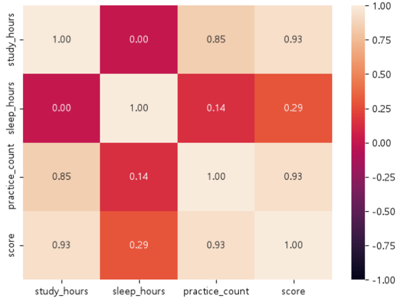
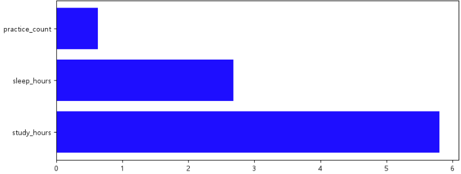
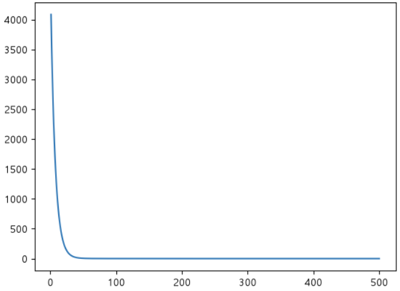
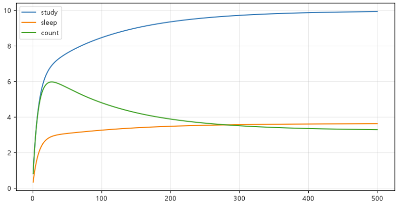
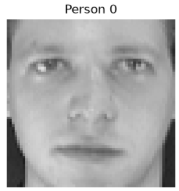
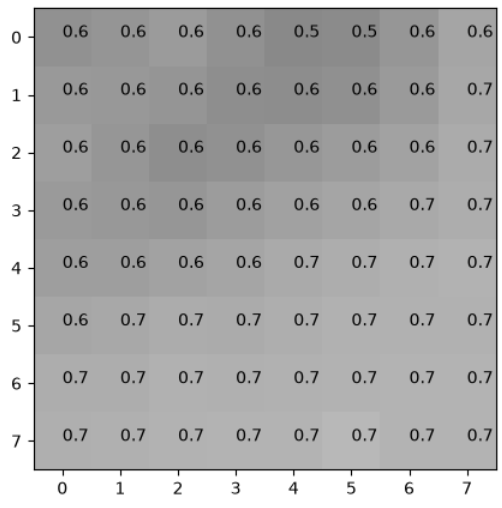

# 01 [ML] 다중선형회귀(Multiple Linear Regression) (2/2)

## 🔽 관련 개념
- 다중 선형회귀 : 여러 개의 원인(독립변수)을 입체적으로 조합,  
  하나의 결과(종속 변수)를 정밀하게 예측하는 알고리즘

## 1️⃣ 라이브러리 임포트 및 데이터 생성

```py
import pandas as pd
import matplotlib.pyplot as plt
import seaborn as sns

from sklearn.linear_model import LinearRegression

from sklearn.metrics import mean_absolute_error
from sklearn.metrics import mean_squared_error
from sklearn.metrics import r2_score

# 공부시간, 수면시간, 연습량(문제풀이 개수), 성적 데이터
df = pd.DataFrame({
    "study_hours":    [1, 2, 3, 4, 5, 2, 3, 5, 4, 1],
    "sleep_hours":    [6, 8, 5, 7, 8, 5, 8, 6, 6, 8],
    "practice_count": [10, 15, 20, 25, 30, 12, 28, 22, 32, 8],
    "score":          [47, 58, 60, 76, 87, 49, 73, 77, 79, 52]
})

df.head()

# 결과
    study_hours	sleep_hours	practice_count	score
0	1	        6	        10	            47
1	2	        8	        15	            58
2	3       	5	        20	            60
3	4	        7	        25	            76
4	5	        8	        30          	87
```

## 2️⃣ Feature별 상관관계 확인

### 1. 산점도 확인
```py
# 1행 3열의 그래프 영역 생성
fig, axes = plt.subplots(1,3,figsize=(16, 5))

# 공부시간-성적 산점도
sns.scatterplot(
    data = df,
    x="study_hours",
    y="score",
    ax=axes[0]
)

# 수면시간-성적 산점도
sns.scatterplot(
    data = df,
    x="sleep_hours",
    y="score",
    ax=axes[1]
)

# 문제풀이 개수-성적 산점도
sns.scatterplot(
    data = df,
    x="practice_count",
    y="score",
    ax=axes[2]
)

plt.show()
```


### 2. 상관계수(히트맵) 출력

- heatmap(): 숫자를 색깔로 바꿔서 보여주는 그래프를 그리는 함수
  - (ex) 여러 컬럼의 상관계수 값의 크기나 패턴을 색으로 한눈에 비교

```py
# 모든 컬럼 사이의 상관계수 확인
corr = df.corr()
# 참고 : 컬럼 하나에서 .corr 쓸때는 df["컬럼1"].corr(df["컬럼2"])

# 캔버스 생성
plt.figure(figsize=(7,5))

# 히트맵 그리기(seaborn)
sns.heatmap(
    corr,       # 히트맵으로 그릴 데이터 : 상관계수 표
    annot=True, # 각 칸에 상관계수 값 표시
    vmin=-1,    # 색상 기준의 최솟값
    vmax=1,     # 색상 기준의 최댓값
    fmt=".2f"
)
plt.show()
```



[참고] 히트맵 그리기 옵션

| 항목 | 역할 | 예시 |
|---|---|---|
| `data` | 히트맵으로 표시할 데이터 | `corr` |
| `annot` | 각 칸에 숫자 표시 여부 | `True`: 표시, `False`: 표시 안 함 |
| `cmap` | 값에 따라 사용할 색상표 | `"coolwarm"` |
| `vmin` | 색상 기준의 최솟값 | `-1` |
| `vmax` | 색상 기준의 최댓값 | `1` |
| `fmt` | 칸에 표시하는 숫자의 형식 | `".2f"`: 소수점 둘째 자리까지 |


## 3️⃣ 데이터 준비 및 학습, 시각화

### 1. 입력 데이터(X), 정답 데이터(y) 분리

```py
# 다중선형회귀 > 복수 개(여러개 열)의 입력 데이터 활용!

# 모델 입력값으로 사용할 df 열 이름들을 features 리스트로 저장
features = [
    "study_hours",
    "sleep_hours",
    "practice_count"
]

# df[특성열 이름 리스트]로 입력 데이터(X) 저장 (2차원, 배열)
X = df[features] # 이미 features가 리스트여서 [] 쓰지 않음
print(X.shape) # (10, 3)

# 실제 성적열을 정답데이터(y)로 저장 (1차원, series)
y = df["score"]
print(y.shape) # (10,)
```

### 2. 다중 선형회귀 모델 생성, 학습
```py
# 다중 선형회귀 모델 객체 생성
model = LinearRegression() # 단순 선형회귀와 동일한 모델 객체

# 입력 데이터(3열 짜리 배열), 출력 데이터(1열짜리 series)
model.fit(X,y)
```

### 3. 모델이 학습한 가중치(weight), 절편(bias) 확인
- 일반 선형회귀(독립변수 1개)는 한 개의 가중치(coef_)가 return 됨
- 이번 다중선형회귀에서는 3개의 독립변수를 넣었으므로 가중치 3개(w1,w2,w3) return 됨
- ⭐ 즉, 독립변수 하나당 가중치가 하나씩 return 됨!
```py
print("가중치:", model.coef_) # 1행 3열짜리 배열로 출력(가중치 3개)
print("절편:", model.intercept_) # 예측값이 하나인 경우 절편은 하나
# 가중치: [5.80222725 2.68100001 0.63219852]
# 절편: 17.66020808020665
```

[참고] LinearRegressin(선형회귀 모델)과 SGDRegressor(경사하강법 모델)비교

| 모델 | 넣은 `y`의 형태 | 학습 후 절편의 형태 |
|---|---|---|
| `LinearRegression` | 1차원 `(10,)` | 숫자 하나 |
| `SGDRegressor` | 1차원 `(10,)` | 원소가 하나인 배열 `(1,)` |

- 두 모델의 가중치, 편향 반환값 비교
```py
X = df[["study_hours"]]
y = df["score"]

linear = LinearRegression()
linear.fit(X, y)

sgd = SGDRegressor()
sgd.fit(X, y)

print(linear.intercept_)  # 예: 34.74    → 숫자로 반환
print(sgd.intercept_)     # 예: [34.74]  → 배열로 반환
```

### 4. 가중치 데이터프레임 생성 및 시각화
```py
# 가중치 df : 특성과 각 가중치를 짝지어 정리, 그 결과를 그래프에 사용
coef_df = pd.DataFrame({
    "feature": features, 
    "weight": model.coef_
})

coef_df
# 출력 결과
    feature	        weight
0	study_hours	    5.802227
1	sleep_hours	    2.681000
2	practice_count	0.632199

# 캔버스 생성
plt.figure(figsize=(10,4))

# 가로바 막대 그래프(bar-horizontal) 그리기
plt.barh(
    coef_df["feature"], # 세로축에 feature 표시
    coef_df["weight"],  # 가로축에 가중치 표시
    color = "blue"      # 막대 색상
)
```


## 4️⃣ 새 데이터로 예측 및 회귀식 확인

### 1. 새 데이터 생성 및 예측
```py
# 새 데이터 생성 : 공부시간 4시간, 수면시간 7시간, 문제풀이 30개
new_data = pd.DataFrame({
    "study_hours":[4],
    "sleeping_hours":[7],
    "practice_count":[30]
})

# 학습한 모델로 시험 성적 예측
prediction = model.predict(new_data)

# 예측 결과
print(f"예측 성적: {prediction[0]:.2f}") # 78.60
```

### 2. predict 결과와 회귀식 값 비교
```py
# 학습된 가중치(기울기)
w1, w2, w3 = model.coef_   # 나눠 담기

# 학습된 절편
b = model.intercept_

# 다중 회귀 공식에 대입
result = w1 * x1 + w2 * x2 + w3 * x3 + b

print(f"직접 계산 : {result:.4f}")           # 78.6021
print(f"predict 계산 : {prediction[0]:.4f}") # 78.6021
```

## 5️⃣ 모델 평가

### 1. 실제값과 예측값 오차 비교
```py
# 전체 학습 데이터에 대한 예측값
y_pred = model.predict(X)
y_pred
# array([45.87042059, 60.19564045, 61.11586028, 75.44108015, 87.08530001,
#        50.25604487, 74.21644847, 76.66571183, 77.18546979, 49.96802356])

# 실제값과 예측값 비교하기 위해 원본 df 복사본 생성
result_df = df.copy()

# 기존 df 복사본에 예측값 컬럼 추가
result_df["예측값"] = y_pred

# 오차 계산(배열 연산), result_df의 새 열과 값으로 추가
result_df["예측오차"] = y - y_pred # 정답값 배열 - 예측값 배열

result_df.round(2).head()

# 결과(열 편집)
    score	예측값	예측오차
0	47	    45.87	1.13
1	58	    60.20	-2.20
2	60	    61.12	-1.12
3	76	    75.44	0.56
4	87	    87.09	-0.09
```

### 2. MAE, MSE (비용) 평가

```py
# 오차 절대 평균 (MAE)
mae = mean_absolute_error(y, y_pred)

# 오차 제곱 평균 (MSE)
mse = mean_squared_error(y, y_pred)

# R2 score 결정 계수
r2 = r2_score(y, y_pred)

print(f"MAE:{mae:.4f}") # MAE:1.1739
# 예측값이 실제값과 평균적으로 약 1.17만큼 차이난다는 의미
print(f"MSE:{mse:.4f}") # MSE:1.8252
print(f"R2:{r2:.4f}") # R2:0.9900
# 결정계수가 1에 가까움, 대부분의 예측값이 실제값과 일치
```

## 6️⃣ 테스트데이터 활용 모델 학습 ⭐

### 1. 학습 데이터와 테스트 데이터 분리
- X_train, X_test, y_train, y_test : 학습 입력값, 테스트 입력값, 학습 정답, 테스트 정답으로 분리

```py
# 학습-테스트 데이터 분리 함수 임포트
from sklearn.model_selection import train_test_split

# 분리한 결과를 네 개의 변수에 나눠 담기
X_train, X_test, y_train, y_test = train_test_split(
    X, # 입력값
    y, # 정답값
    test_size = 0.3, # 전체 데이터의 30%를 테스트 데이터로 설정
    random_state = 42
    # 어떤 행을 테스트용으로 뽑을지 무작위로 결정할 때 쓰는 시드 
)

# 각 변수별 shape로 데이터가 의도한 대로 잘 나뉘었는지 확인
print("X_train", X_train.shape) # (7, 3) 총 10개 데이터 중 70%가 학습용
print("X_test", X_test.shape) # (3, 3) 총 10개 데이터 중 30%가 테스트용

# 학습용, 테스트용 정답 개수가 입력데이터 개수와 일치하는지 확인
print("y_train", y_train.shape) # (7,)
print("y_test", y_test.shape) # (3,)
```

### 2. 분리한 학습용 데이터로 모델 학습
```py
test_model = LinearRegression()  # 새 모델 생성

# 70% 학습 데이터로만 학습
test_model.fit(X_train, y_train) 

# 따로 떼어놓은(미학습 데이터) 테스트 데이터로 예측
test_pred = test_model.predict(X_test)
```

### 3. 모델 평가
```py
# 모델 평가
print(f"MAE: {mean_absolute_error(y_test, test_pred):.4f}") # MAE: 3.0870
print(f"MSE: {mean_squared_error(y_test, test_pred):.4f}") # MSE: 10.6380
print(f"R2: {r2_score(y_test, test_pred):.4f}") # R2: 0.9327

# 이전 모델보다 오차율이 증가
```

## 7️⃣ 특성 스케일링(Feature Scaling) ⭐
- 서로 다른 단위 또는 크기를 가진 데이터를 비슷한 척도로 변환하는 전처리 과정 

### 1.  통계 요약 확인
```py
# describe() : 기초적인 통계 수치 확인
X.describe().round(2)

# 결과
study_hours	sleep_hours	practice_count
count	10.00	10.00	10.00
mean	3.00	6.70	20.20
std	1.49	1.25	8.63
min	1.00	5.00	8.00
25%	2.00	6.00	12.75
50%	3.00	6.50	21.00
75%	4.00	8.00	27.25
max	5.00	8.00	32.00
```

### 2. StandardScaler 활용
- StandardScaler : 학습 데이터에 대해 평균, 표준편차를 계산하고 데이터를 표준화(변환)
  - scaler.fit : 학습데이터 기준(각 열의 평균과 표준편차) 알아내고 저장하기
  - scaler.transform : fit()으로 저장한 평균과 표준편차를 이용해 X_train 각 값을 변환
  - 변환 결과값 : 원래 값이 평균보다 얼마나 크거나 작은지 나타내므로 음수 ~ 1 값 등 나옴

```py
# 표준화 도구 가져오기
from sklearn.preprocessing import StandardScaler

# 표준화 도구 만들기(객체 생성)
scaler = StandardScaler()

# 학습 데이터로 열별 평균과 표준편차에 따라 값 표준화, 변환값 따로 저장
X_train_scaled = scaler.fit_transform(X_train)

# 모델이 표준화된 입력값(ex -1.38)으로 학습, 테스트 데이터도 같은 기준으로 변환해야 예측 가능
X_test_scaled = scaler.transform(X_test) # 학습 데이터 표준화 기준에 맞추므로 fit 또 하지 X

# 표준화된 학습데이터(공부시간, 수면시간, 연습량)를 열 이름이 있는 있는 표로 만들기
scaled_df = pd.DataFrame(
    X_train_scaled,     # (배열) [[-1.38086193 -0.76200076 -1.32182189][][]...]
    columns = features  # features = ["study_hours", "sleep_hours", "practice_count"]
)

scaled_df.round(2)

# 결과
study_hours	sleep_hours	practice_count
0	-1.38	-0.76	-1.32
1	1.20	-0.76	0.20
2	-0.09	-1.65	-0.05
3	-1.38	1.02	-1.58
4	1.20	1.02	1.21
5	0.55	0.13	0.58
6	-0.09	1.02	0.96
```

[참고] 표준화된 입력값으로 학습을 한 모델은 우리가 알아볼 수 있는 결과를 줄까? YES!
- 모델의 입력값은 표준화하고 예측 결과는 표준화하지 않기 때문
- 즉, 모델은 표준화된 입력값을 받아서 원래 단위의 정답을 내도록 학습

| 모델에 들어가는 입력(X_train_scaled) | 모델이 학습하는 정답(y_train) |
|---:|---:|
| 표준화된 공부 시간 `-1` | 실제 점수 `60점` |
| 표준화된 공부 시간 `0` | 실제 점수 `70점` |
| 표준화된 공부 시간 `1` | 실제 점수 `80점` |


## 7️⃣ 경사하강법을 이용한 다중 선형회귀
- 다중회귀에서도 단순 선형회귀에서 썼던 SGDRegressor 모델 객체를 그대로 활용
- 다중회귀 경사하강법에서는 입력변수가 여러 개, 출력변수가 1개 
- 데이터 표준화 후 경사하강법 적용 시, 특성 크기차가 줄어 학습 속도와 안정성 높아질 가능성 O

[참고] 표준화 꼭 해야할까?

| 모델·학습 방식 | 표준화 필요성 | 이유 |
|---|---|---|
| `LinearRegression()` | 필수 아님 | 보통 경사하강법 대신 다른 수치 계산 방법으로 가중치를 구함 |
| `SGDRegressor()` | 필수는 아니지만 권장 | 특성의 크기 차이가 크면 경사하강법의 학습이 느리거나 불안정 |
| KNN | 필수는 아니지만 중요 | 특성의 크기 차이가 거리 계산에 큰 영향|

### 1. 경사하강법 모델 학습 및 예측 성능 평가
```py
# 경사하강법 도구 임포트
from sklearn.linear_model import SGDRegressor

# 경사하강법 객체(모델) 생성
sgd = SGDRegressor(
    loss = "squared_error",     # MSE 기반 손실함수 활용
    learning_rate = "constant", # 학습률 변화없이 일정하게 유지
    eta0 = 0.01,                # 초기 학습률, 0.01이 가장 일반적
    max_iter = 3000,            # 최대 epoch(전체 데이터 기준) 수
    random_state = 42           # 난수 발생 시드
)

# 표준화된 학습 데이터(70%)로 모델 학습
sgd.fit(X_train_scaled, y_train)

# 표준화된 테스트 데이터(30%)로 모델 예측, 테스트 결과 저장
sgd_pred = sgd.predict(X_test_scaled)

# 모델 평가(테스트 데이터 정답과 예측값 비교)
print(f"MAE: {mean_absolute_error(y_test, sgd_pred):.4f}")
# 기존 선형회귀 테스트 MAE: 3.0870 / 현재 MAE: 2.8169 * 더 작아짐, 오차 감소
print(f"MSE: {mean_squared_error(y_test, sgd_pred):.4f}")
# 기존 선형회귀 테스트 MSE: 10.6380 / 현재 MSE: 8.5966 * 더 작아짐, 오차 감소
print(f"R2: {r2_score(y_test, sgd_pred):.4f}")
# 기존 선형회귀 테스트 R2: 0.9327 / 현재 R2: 0.9456 * 더 커짐, 예측률 증가
```

### 2. partial_fit으로 한번씩 학습하며 과정별 가중치, MSE 변화 추적
```py
# 경사하강법 객체(모델) 재교육
sgd = SGDRegressor(
    loss = "squared_error",     # MSE 기반 손실함수 활용
    learning_rate = "constant", # 학습률 변화없이 일정하게 유지
    eta0 = 0.01,                # 초기 학습률, 0.01이 가장 일반적
    random_state = 42           # 난수 발생 시드
)

history = []

for epoch in range(500): # 500번 학습

    # 1 epoch 한번 학습
    sgd.partial_fit(X_train_scaled, y_train) # 학습 데이터, 학습 정답
    
    # 해당 epoch 시점의 예측 결과값
    pred = sgd.predict(X_train_scaled)

    history.append({
        "epoch":epoch+1,
        "w1":sgd.coef_[0], # 현재 epoch 가중치 배열 첫째값(feature: study_hours) 
        "w2":sgd.coef_[1], # 현재 epoch 가중치 배열 둘째값(feature: sleep_hours)
        "w3":sgd.coef_[2], # 현재 epoch 가중치 배열 셋째값(feature: practice_count)
        "bias":sgd.intercept_[0], # SGDRegressor는 절편 하나를 배열 안에 넣어 보관하므로 [0]
        "mse":mean_squared_error(y_train, pred) # 학습 데이터에 대한 오차 제곱 평균 MSE
    })

history_df = pd.DataFrame(history)

history_df.tail(5)

# 결과
    epoch	w1	        w2      	w3	        bias	    mse
495	496 	9.924025	3.620886	3.290704	67.424572	0.144615
496	497	    9.924418	3.620984	3.290298	67.424569	0.144605
497	498	    9.924807	3.621080	3.289895	67.424567	0.144594
498	499	    9.925193	3.621176	3.289496	67.424564	0.144584
499	500	    9.925575	3.621271	3.289101	67.424562	0.144573
```

### 3. 차트 그리기

#### (1) 손실 곡선
```py
# 손실 곡선 : X = epoch, y = mse
plt.plot(
    history_df["epoch"],
    history_df["mse"]
)
plt.show()
```


#### (2) 각 특성별 가중치(w1,w2,w3) 변화 그래프
```py
fig, ax = plt.subplots(figsize=(10,5))

# 하나의 캔버스에 세 그래프를 같이 그리는거라 ax[0]~[2] 등 인덱스는 쓰지 않음

# 학습 epoch 누적에 따른 w1(study_hours 특성의 가중치) 변화 그래프
ax.plot(
    history_df["epoch"], # 1 ~ 500
    history_df["w1"],    # 각 epoch 당시 study_hours 특성의 가중치
    label="study",
)

# 학습 epoch 누적에 따른 w2(sleep_hours 특성의 가중치) 변화 그래프
ax.plot(
    history_df["epoch"], # 1 ~ 500
    history_df["w2"],    # 각 epoch 당시 sleep_hours 특성의 가중치
    label = "sleep"
)

# 학습 epoch 누적에 따른 w3(practice_count 특성의 가중치) 변화 그래프
ax.plot(
    history_df["epoch"], # 1 ~ 500
    history_df["w3"],    # 각 epoch 당시 practice_count 특성의 가중치
    label = "count"
)

plt.legend()
plt.grid(alpha=0.3)
plt.show()
``` 



# 02 [ML] KNN(K-Nearest Neighbors) 분류 

## 🔽 관련 개념

- KNN(K-Nearest Neighbors) : 새로운 데이터와 가까운 기존 데이터(이웃, 학습데이터 한 행) 찾고,  
  그 이웃들의 정답을 참고해 새 데이터의 답을 예측하는 모델 (ex 다양한 얼굴 사진으로 사람 분류)
  - K : 몇 개의 이웃을 참고할지 정하는 숫자. 너무 작으면 가까운 소수 이웃에 민감해져 과적합,  
    너무 크면 넓은 범위의 이웃을 참고하면서 과소적합 가능성 생김
  - '가깝다'는 것은 입력 데이터 x의 값이 비슷하다는 뜻!

```txt
(ex) 얼굴 사진으로 사람 분류하기

새 사진 → 기존 사진들과 얼마나 비슷한지 계산
        → 가장 가까운 사진 K개 선택 : K=3일때, 가장 가까운 이웃 3 선정
        → 그 사진들의 정답 확인 : 이웃 1 정답 A, 이웃 2 정답 A, 이웃 3 정답 B
        → 최종 인물 예측(이웃들의 정답 방향대로) : A가 많으므로 A로 예측 
```

## 1️⃣ 사전 작업

### 1. 도구 및 데이터 준비
```py
# 라이브러리 임포트
import numpy as np
import matplotlib.pyplot as plt
from sklearn.datasets import fetch_olivetti_faces # 얼굴 데이터셋 가져오기
```
[참고] fetch_olivetti_faces() 데이터 형태 분석

- fetch_olivetti_faces() 는 기본적으로 데이터프레임이 아니라 Bunch 객체를 반환
  - Bunch : 여러 데이터를 이름표를 붙여 한곳에 담아 놓은, 딕셔너리처럼 사용할 수 있는 객체 

- faces.key()로 Bunch 내 이름표들 확인 가능 (dict_keys(['data', 'images', 'target', 'DESCR']))
  - data : 픽셀값 4096개를 한 줄로 펼친 데이터
  - images : 64*64 사진 모양 픽셀값 데이터
  - target : 정답 사람 번호

|  | 사진 한 장의 형태 | 주로 사용하는 곳 |
|---|---|---|
| `faces.images[0]` | `(64, 64)` | plt.imshoew()로 사진을 화면에 보여줄 때 사용 |
| `faces.data[0]` | `(4096,)` | 데이터를 행렬로 받는 모델에 입력할 때 사용 |
=> 같은 사진을 화면에 보여주기 좋은 모양과 모델에 넣기 좋은 모양으로 각각 제공하는 것!

- 각 이름표(키)에 대한 값은 배열(전체 사진 400장의 픽셀값들의 배열, 한 장의 정보가 1행이 됨)
```text
# 배열의 각 행은 사진 한 장의 픽셀값 4096개를 한줄로 펼쳐 놓은 것(1행, 4096열)
{'data': array([[0.30991736, 0.3677686 , 0.41735536, ..., 0.15289256, 0.16115703,
         0.1570248 ],
        [0.45454547, 0.47107437, 0.5123967 , ..., 0.15289256, 0.15289256,
         0.15289256],...])}
```

### 2. 데이터 확인, 사진 출력

#### (1) 데이터 다운로드 및 정보 확인
```py
# 데이터 다운로드
faces = fetch_olivetti_faces(data_home="./datasets") # 저장경로(datasets) 지정

# 데이터 크기 조회
print("사진 묶음 크기:", faces.images.shape) # (400, 64, 64)

# 데이터 정답 크기 조회
print("정답 묶음 크기:", faces.target.shape) # (400,)

# np.unique() : 중복을 제거한 고유한 값들을 NumPy 배열 형태로 반환하는 함수
print("사람 종류:", np.unique(faces.target)) # 사람 번호 0~39번
# [ 0  1  2  3  4  5  6  7  8  9 10 11 12 13 14 15 16 17 18 19 20
# 21 22 23 24 25 26 27 28 29 30 31 32 33 34 35 36 37 38 39]

print("사람 수:", len(np.unique(faces.target))) # 총 40명의 사진인 것 확인

# [참고] 각 사람이 사진을 몇 장씩 가지고 있는지도 확인 가능!
# np.unique에 return_counts=True를 넣으면 고유한 값, 각 값 나온 횟수 함께 반환
people, counts = np.unique(faces.target, return_counts=True)

print("사람 번호:", people) # [0, 1, ..., 39]
print("사진 장수:", counts) # [10, 10, ..., 10]
```

#### (2) 사진 한 장 출력 해보기 : .imshow()
- imshow() : 배열에 있는 숫자(픽셀값)들을 색이나 밝기로 바꿔서 이미지로 보여주는 함수

```py
# 캔버스 생성
plt.figure(figsize=(3,3))

# 0번째 사진 출력
plt.imshow(faces.images[0], cmap="gray", vmin=0, vmax=1)
# cmap "gray" 사용 시, 낮은 값(0으로 갈수록) 어둡게, 높은 값(1로 갈수록) 밝게 표시

# 제목에 정답 번호(사람 번호) 표시
plt.title(f"Person {faces.target[0]}")

# 그래프 주변 축과 눈금 화면에서 숨기기
plt.axis("off") 

plt.show()
```


- 사진 일부 칸들의 값 확인
```py
# 일부 칸(8*8) 값 확인
corner = faces.images[0][20:28,20:28]
# 28 미포함(x 20~27(8칸)*y 20~27(8칸))

# 0번 사진의 픽셀 최소, 최댓값 확인
print("가장 어두운 값:", faces.images[0].min()) # 0.08264463
print("가장 밝은 값:", faces.images[0].max()) # 0.87603307
```

- 8*8 사진 위에 픽셀값 표시하기
  - ax.text(x,y,"글자") : 그래프 영역 ax의 원하는 위치에 글자를 적는 메서드
```py
# 캔버스 생성
fig, ax = plt.subplots(figsize=(5,5))

# corner(사진 일부 8*8) 출력
ax.imshow(corner, cmap="gray", vmin=0, vmax=1)

# corner 각 픽셀에 숫자값 병기하기
for r in range(8):      # row
    for c in range(8):  # column
        # r번째 행의 c번째 열 픽셀에 대해
        
        # 픽셀값 구하기
        v = corner[r,c] # v = r행 c열의 픽셀값(숫자)
        # corner, 즉 faces.images~에는 픽셀값이 저장되어있다!
        
        # 숫자 출력하기
        ax.text(c,r, f"{v:.1f}") # c열, r행에 v 숫자값 출력

plt.show()
```


#### (3) 한 사람의 모든 사진(10장) 출력해보기
- zip(자료1, 자료2) : 여러 자료에서 같은 위치 값들을 하나씩 짝짓는 함수,  
  차례대로 꺼낼 수 있는 zip 객체를 반환
  - 여러 자료를 같은 순서로 동시에 꺼내서 처리하기 편하여 for과 자주 같이 씀
  - 인덱스로 각 자료에서 따로따로 꺼내서 합치는 것보다 훨씬 간단하고 직접적

```py
# 한 사람의 사진 10장 모두 출력하는 함수 정의
def show_person(person):  # 사람 번호를 인수로 받음
    
    # 정답 번호 = 인수 번호일때 사진 출력
    pics = faces.images[faces.target == person] 

    # 1행, 10열 캔버스 생성
    fig, axes = plt.subplots(1, 10, figsize=(15,2))

    # 캔버스(axes)와 사진(pics) 하나씩 짝짓고 각 자리에 사진 출력
    for ax, img in zip(axes, pics):
        ax.imshow(img, cmap="gray", vmin=0, vmax=1)
        ax.axis("off")

    plt.show()

# 0번 인물의 사진 10장 출력
show_person(0)
```

